# Art drafts

Made by the art bot (`tools/art_bot/` on the main branch) from the art tracker's prompts.
191 of 191 stills done. Newest first. These are drafts: copy the
keepers into the game's `assets/` folder by hand.

**To build on a draft** (new weapon or outfit, 8 directions, animations), copy it to
`approved/<KEY>.png` on this branch, for example `approved/PL-01-1.png`.

## Approve to animate

- `approved/PL-02-1.png` unlocks 8 directions, sword slash, sword lunge
- `approved/PL-02-2.png` unlocks 8 directions, quick bow shot, aimed bow shot
- `approved/NP-01-1.png` unlocks 8 directions, idle, talking
- `approved/NP-02-5.png` unlocks 8 directions, idle, walk
- `approved/NP-03-1.png` unlocks 8 directions, idle, talking
- `approved/NP-04-1.png` unlocks 8 directions, idle, talking
- `approved/NP-05-1.png` unlocks 8 directions, idle, walk, talking
- `approved/NP-05-2.png` unlocks 8 directions, idle, walk, talking
- `approved/EN-02-1.png` unlocks 8 directions, idle, walk, attack, death
- `approved/BO-01-1.png` unlocks 8 directions, idle, attack, winding up a big attack, phase change, death
- `approved/BO-01-2.png` unlocks 8 directions, idle, attack, winding up a big attack, phase change, death
- `approved/NP-06-1.png` unlocks 8 directions, idle, talking
- `approved/EN-03-1.png` unlocks 8 directions, idle, run, bite, death
- `approved/EN-04-1.png` unlocks 8 directions, fly, dive, death
- `approved/BO-02-1.png` unlocks 8 directions, idle, slam, winding up a big attack, burn, death
- `approved/EN-05-1.png` unlocks 8 directions, idle, run, pounce, death
- `approved/EN-06-1.png` unlocks 8 directions, fly, dive, death
- `approved/BO-03-1.png` unlocks 8 directions, rise, bite, coil, submerge, death
- `approved/NP-09-1.png` unlocks 8 directions, idle, talking, earth cast, death
- `approved/EN-07-1.png` unlocks 8 directions, idle, walk, slam, death
- `approved/NP-10-1.png` unlocks 8 directions, idle, talking, meditate
- `approved/NP-11-1.png` unlocks 8 directions, idle, walk, attack, death
- `approved/EN-08-1.png` unlocks 8 directions, idle, move, attack
- `approved/EN-08-2.png` unlocks 8 directions, idle, move, attack
- `approved/BO-04-1.png` unlocks 8 directions, idle, cast, winding up a big attack, death
- `approved/BO-06-1.png` unlocks 8 directions, powering up between phases, capstone cast, death
- `approved/FX-07-2.png` unlocks water ribbon lashes out to the right, snaps straight, then splashes apart
- `approved/FX-07-3.png` unlocks droplets rise and spiral together into the glowing water ball
- `approved/FX-07-4.png` unlocks water ribbons spiral up from the ground, then burst into rising sparkles and a soft mist that fades
- `approved/FX-07-5.png` unlocks wind puff shoots to the right with a small burst of air, then dissolves
- `approved/FX-07-6.png` unlocks wind cone spreads wider toward the right, leaves tumbling, then fades
- `approved/FX-07-7.png` unlocks fire burst blasts to the right and breaks into embers
- `approved/FX-07-8.png` unlocks flame crescent sweeps around in a fast arc, then fades into embers
- `approved/FX-09-2.png` unlocks a tiny curl of water grows into a large S-shaped lash, snaps, then breaks apart into flying droplets and bursts into a star-shaped splash that fades
- `approved/FX-08-1.png` unlocks the spiral of wind spins and shoots to the right, then thins out and fades away
- `approved/FX-08-2.png` unlocks the spiral of wind spins and shoots to the right, then thins out and fades away
- `approved/FX-08-3.png` unlocks the spiral of wind spins and shoots to the right, then thins out and fades away
- `approved/FX-08-4.png` unlocks the spiralling wind sweeps outward to the right, widening and swirling, then fades away
- `approved/FX-08-6.png` unlocks the spiralling wind sweeps outward to the right, widening and swirling, then fades away
- `approved/FX-10-3.png` unlocks the flame arc sweeps around fast in a half circle, then fades into embers
- `approved/FX-10-5.png` unlocks the rock flies forward to the right across the canvas in a low arc, tumbling end over end; it travels alone, no pebbles or dust follow it
- `approved/FX-11-1.png` unlocks the fire burst blasts to the right and breaks into embers
- `approved/FX-11-2.png` unlocks the flame bolt flickers as it flies to the right, the flame bolt pops into a small burst of sparks
- `approved/FX-11-3.png` unlocks the sparks crackle and flicker, then fade
- `approved/FX-11-4.png` unlocks the golden flames rise up around the ring and fade into embers
- `approved/FX-11-5.png` unlocks the band of flame flickers and roars in a seamless loop
- `approved/FX-11-6.png` unlocks the low flames flicker across the tile in a seamless loop
- `approved/FX-11-7.png` unlocks the heat haze shimmers and embers rise in a loop, the heat bursts outward in a ring of flame and fades
- `approved/FX-11-8.png` unlocks the flame puffs flare up and die down
- `approved/FX-11-9.png` unlocks the fire lash snaps out to the right, cracks straight, then breaks into embers
- `approved/FX-11-10.png` unlocks the flame jets roar and flicker in a seamless loop
- `approved/FX-11-11.png` unlocks the lightning circles faster and faster, then shoots out to the right
- `approved/FX-11-12.png` unlocks the fire ring explodes outward and the flame wings rise, then fade
- `approved/FX-11-13.png` unlocks the fireball flickers as it flies to the right, the fireball explodes into a round burst of flame and smoke
- `approved/FX-11-14.png` unlocks the sun halo pulses and its rays turn slowly in a loop
- `approved/FX-11-15.png` unlocks the lightning bolt strikes across in a bright flash and flickers out
- `approved/FX-11-16.png` unlocks the ring of fire spins around and flares, then fades
- `approved/FX-11-17.png` unlocks the firestorm swirls and roars in a seamless loop
- `approved/FX-11-18.png` unlocks the cone of fire breath blasts outward to the right, then thins into embers
- `approved/FX-11-19.png` unlocks the explosion bursts from a bright point, a shockwave ring spreads, then smoke fades
- `approved/FX-12-1.png` unlocks the ground shock spreads outward from the middle in a ring of dust and fades
- `approved/FX-12-2.png` unlocks the dust bursts outward and settles
- `approved/FX-12-3.png` unlocks the metal shards spin slightly as they fly to the right, the shards hit with a small burst of white sparks
- `approved/FX-12-4.png` unlocks the stones circle slowly around the middle in a loop, the stones break apart and fall as dust
- `approved/FX-12-5.png` unlocks the tile cracks and sinks down with crumbling edges and dust
- `approved/FX-12-6.png` unlocks the metal glints ripple and twist inward, then fade
- `approved/FX-12-7.png` unlocks the amber glow pulses softly in a loop
- `approved/FX-12-8.png` unlocks the ripples pulse outward from the middle and fade
- `approved/FX-12-9.png` unlocks the cable shoots out to the right and the hook bites in
- `approved/FX-12-10.png` unlocks the boulder drops straight down, the boulder slams into the ground and breaks into fragments and dust
- `approved/FX-12-11.png` unlocks the lava bubbles and glows in a seamless loop
- `approved/FX-12-12.png` unlocks the cracks shake and widen while dust rises, in a loop
- `approved/FX-12-13.png` unlocks the sand swirls around in a seamless loop
- `approved/FX-13-1.png` unlocks droplets rise and spiral together into the glowing water ball
- `approved/FX-13-2.png` unlocks the water ribbons spiral up, then burst into rising green-blue sparkles that fade
- `approved/FX-13-3.png` unlocks the water bubble wobbles gently in a loop, the bubble bursts and splashes outward
- `approved/FX-13-4.png` unlocks the ice shard spins slightly as it flies to the right, the ice shard shatters into small glittering pieces
- `approved/FX-13-5.png` unlocks the mist drifts and swirls gently in a loop
- `approved/FX-13-6.png` unlocks the water tendril pulls droplets from the right to the left, then fades
- `approved/FX-13-7.png` unlocks the droplets circle slowly in a loop, glowing
- `approved/FX-13-8.png` unlocks the ice forms upward from the ground into a block, the ice block cracks and shatters
- `approved/FX-13-9.png` unlocks the column of water and light rises up from the ground, glows, then fades
- `approved/FX-13-10.png` unlocks the water wave rolls forward to the right and splashes down
- `approved/FX-13-11.png` unlocks the water streams swirl quickly in a loop
- `approved/FX-13-12.png` unlocks the ice block rises up out of the ground, the ice block cracks and shatters
- `approved/FX-13-13.png` unlocks the spirit water ribbon winds upward and glows brighter, then fades into sparkles
- `approved/FX-13-14.png` unlocks the water jet surges in a seamless loop
- `approved/FX-13-15.png` unlocks the steam billows and drifts in a seamless loop
- `approved/FX-13-16.png` unlocks the dark-red threads tighten and pulse in a loop
- `approved/FX-13-17.png` unlocks glowing raindrops fall and splash softly in a seamless loop
- `approved/FX-13-18.png` unlocks the big wave rolls forward to the right, crests and crashes down
- `approved/FX-13-19.png` unlocks the water ring rises up and golden sparkles burst, then fade
- `approved/FX-13-20.png` unlocks the ice spikes erupt up out of the ground, hold, then crumble
- `approved/FX-13-21.png` unlocks the eight water arms sway slowly in a loop, the water arms lash outward in all directions, then return
- `approved/FX-14-1.png` unlocks the wind blade flies to the right and thins out
- `approved/FX-14-2.png` unlocks the air puff bursts out and fades
- `approved/FX-14-3.png` unlocks the wind band coils tight around the legs in a loop
- `approved/FX-14-4.png` unlocks the air wisps are pulled to the left and vanish
- `approved/FX-14-5.png` unlocks the air ball spins in a seamless loop
- `approved/FX-14-6.png` unlocks the storm wind swirls with rain in a seamless loop
- `approved/FX-14-7.png` unlocks the wind blast shoots to the right and dissolves
- `approved/FX-14-8.png` unlocks the air bubble swirls in a loop, the air bubble flashes bright as it reflects a shot
- `approved/FX-14-9.png` unlocks the wind swirl bursts outward and fades
- `approved/FX-14-10.png` unlocks the spiral swirls inward toward the middle in a loop
- `approved/FX-14-11.png` unlocks the wind column rushes upward, then fades
- `approved/FX-14-12.png` unlocks the air ring tightens and spins in a loop
- `approved/FX-14-13.png` unlocks the wind streams trail and curl in a seamless loop
- `approved/FX-14-14.png` unlocks the tornado spins in a seamless loop
- `approved/FX-14-15.png` unlocks the wind ring spins and expands outward, then fades
- `approved/FX-14-16.png` unlocks the pressure ring slams down and holds, then releases
- `approved/FX-14-17.png` unlocks the feathers and wisps float upward gently in a loop
- `approved/FX-14-18.png` unlocks the storm wind whips around in a seamless loop
- `approved/FX-15-1.png` unlocks the embers drift upward in a seamless loop
- `approved/FX-15-2.png` unlocks the flame ribbons circle in a seamless loop
- `approved/FX-15-3.png` unlocks the heel flames flicker in a seamless loop
- `approved/FX-15-4.png` unlocks the sun glows and sparks crackle in a seamless loop
- `approved/FX-15-5.png` unlocks the fire dragon coils around in a seamless loop
- `approved/FX-15-6.png` unlocks the stone plates orbit in a seamless loop
- `approved/FX-15-7.png` unlocks the ground ripples spread in a seamless loop
- `approved/FX-15-8.png` unlocks the boulder bobs gently in a seamless loop
- `approved/FX-15-9.png` unlocks the boulders orbit in a seamless loop
- `approved/FX-15-10.png` unlocks the water rope circles in a seamless loop
- `approved/FX-15-11.png` unlocks the water hoop rotates in a seamless loop
- `approved/FX-15-12.png` unlocks the water sphere wobbles and turns in a seamless loop
- `approved/FX-15-13.png` unlocks the water arms sway in a seamless loop
- `approved/FX-15-14.png` unlocks the wind swirl circles in a seamless loop
- `approved/FX-15-15.png` unlocks the air ring spins in a seamless loop
- `approved/FX-15-16.png` unlocks the arm cyclones spin in a seamless loop
- `approved/FX-15-17.png` unlocks the wind column rises in a seamless loop

## Drafts

### FX-11-1 · Fire ability effects for the stance rework (2026-11-22)

a short burst of orange and yellow fire about 16 px long with a white-hot core, blasting to the right from a point near the left edge. A standing person in this game is 32 px tall and 16 px wide; one ground tile is a 32x16 diamond. Game spell/attack effect sprite, isometric view, glowing, bright rea

### FX-11-2 · Fire ability effects for the stance rework (2026-11-22)

a small bolt of flame about 10 px long with a short flickering tail, pointing to the right, in the middle of the canvas. A standing person in this game is 32 px tall and 16 px wide; one ground tile is a 32x16 diamond. Game spell/attack effect sprite, isometric view, glowing, bright readable colors, 

### FX-11-3 · Fire ability effects for the stance rework (2026-11-22)

a small crackle of blue-white electric sparks about 14 px across, in the middle of the canvas. A standing person in this game is 32 px tall and 16 px wide; one ground tile is a 32x16 diamond. Game spell/attack effect sprite, isometric view, glowing, bright readable colors, 32x32 canvas. pixel art, i

### FX-11-4 · Fire ability effects for the stance rework (2026-11-22)

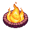

warm golden flames rising softly from the ground in a ring the width of a standing person, the middle left empty. A standing person in this game is 32 px tall and 16 px wide; one ground tile is a 32x16 diamond. Game spell/attack effect sprite, isometric view, glowing, bright readable colors, 64x64 c

### FX-11-5 · Fire ability effects for the stance rework (2026-11-22)

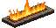

a straight band of orange flame running from the left edge to the right edge, about 10 px thick. A standing person in this game is 32 px tall and 16 px wide; one ground tile is a 32x16 diamond. Game spell/attack effect sprite, isometric view, glowing, bright readable colors, 64x32 canvas. pixel art,

### FX-11-6 · Fire ability effects for the stance rework (2026-11-22)

one flat isometric ground tile, a 32x16 diamond, covered in low flickering flames. A standing person in this game is 32 px tall and 16 px wide; one ground tile is a 32x16 diamond. Game spell/attack effect sprite, isometric view, glowing, bright readable colors, 32x32 canvas. pixel art, isometric 2:1

### FX-11-7 · Fire ability effects for the stance rework (2026-11-22)

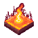

a glowing red-orange heat haze with rising embers around a space the size of a standing person. A standing person in this game is 32 px tall and 16 px wide; one ground tile is a 32x16 diamond. Game spell/attack effect sprite, isometric view, glowing, bright readable colors, 64x64 canvas. pixel art, 

### FX-11-8 · Fire ability effects for the stance rework (2026-11-22)

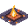

a few small flame puffs on the ground, about 12 px across. A standing person in this game is 32 px tall and 16 px wide; one ground tile is a 32x16 diamond. Game spell/attack effect sprite, isometric view, glowing, bright readable colors, 32x32 canvas. pixel art, isometric 2:1 view, no dark outline, 

### FX-11-9 · Fire ability effects for the stance rework (2026-11-22)

a long thin lash of fire curving from the left edge to the right edge in a gentle S, bright tip. A standing person in this game is 32 px tall and 16 px wide; one ground tile is a 32x16 diamond. Game spell/attack effect sprite, isometric view, glowing, bright readable colors, 64x64 canvas. pixel art,

### FX-11-10 · Fire ability effects for the stance rework (2026-11-22)

two short jets of flame pointing straight down, side by side, about 12 px long, as if shooting from a person's feet. A standing person in this game is 32 px tall and 16 px wide; one ground tile is a 32x16 diamond. Game spell/attack effect sprite, isometric view, glowing, bright readable colors, 32x3

### FX-11-11 · Fire ability effects for the stance rework (2026-11-22)

blue-white lightning curling in a circle around an empty middle, about 40 px across. A standing person in this game is 32 px tall and 16 px wide; one ground tile is a 32x16 diamond. Game spell/attack effect sprite, isometric view, glowing, bright readable colors, 64x64 canvas. pixel art, isometric 2

### FX-11-12 · Fire ability effects for the stance rework (2026-11-22)

a ring of fire bursting outward from the ground with two flame shapes like phoenix wings rising at the sides. A standing person in this game is 32 px tall and 16 px wide; one ground tile is a 32x16 diamond. Game spell/attack effect sprite, isometric view, glowing, bright readable colors, 64x64 canva

### FX-11-13 · Fire ability effects for the stance rework (2026-11-22)

a round fireball about 12 px wide with a short flame tail, pointing to the right, in the middle of the canvas. A standing person in this game is 32 px tall and 16 px wide; one ground tile is a 32x16 diamond. Game spell/attack effect sprite, isometric view, glowing, bright readable colors, 64x64 canv

### FX-11-14 · Fire ability effects for the stance rework (2026-11-22)

a blazing golden sun halo floating where a standing person's head and shoulders would be, rays pointing outward. A standing person in this game is 32 px tall and 16 px wide; one ground tile is a 32x16 diamond. Game spell/attack effect sprite, isometric view, glowing, bright readable colors, 64x64 ca

### FX-11-15 · Fire ability effects for the stance rework (2026-11-22)

a jagged bolt of blue-white lightning crossing the canvas from the left edge to the right edge. A standing person in this game is 32 px tall and 16 px wide; one ground tile is a 32x16 diamond. Game spell/attack effect sprite, isometric view, glowing, bright readable colors, 64x32 canvas. pixel art, 

### FX-11-16 · Fire ability effects for the stance rework (2026-11-22)

a flat ring of fire on the ground, an isometric ellipse about 56 px wide, the middle empty. A standing person in this game is 32 px tall and 16 px wide; one ground tile is a 32x16 diamond. Game spell/attack effect sprite, isometric view, glowing, bright readable colors, 64x64 canvas. pixel art, isom

### FX-11-17 · Fire ability effects for the stance rework (2026-11-22)

one flat isometric ground tile, a 32x16 diamond, with tall swirling flames, a raging firestorm. A standing person in this game is 32 px tall and 16 px wide; one ground tile is a 32x16 diamond. Game spell/attack effect sprite, isometric view, glowing, bright readable colors, 32x48 canvas. pixel art, 

### FX-11-18 · Fire ability effects for the stance rework (2026-11-22)

a cone of orange fire spreading from a point at the left edge toward the right, widening as it goes. A standing person in this game is 32 px tall and 16 px wide; one ground tile is a 32x16 diamond. Game spell/attack effect sprite, isometric view, glowing, bright readable colors, 64x64 canvas. pixel 

### FX-11-19 · Fire ability effects for the stance rework (2026-11-22)

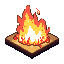

a large explosion of fire and white shockwave, round, filling most of the canvas. A standing person in this game is 32 px tall and 16 px wide; one ground tile is a 32x16 diamond. Game spell/attack effect sprite, isometric view, glowing, bright readable colors, 64x64 canvas. pixel art, isometric 2:1 

### FX-12-1 · Earth ability effects for the stance rework (2026-11-22)

a flat ring of dust and small pebbles on the ground around an empty middle, an isometric ellipse about 48 px wide. A standing person in this game is 32 px tall and 16 px wide; one ground tile is a 32x16 diamond. Game spell/attack effect sprite, isometric view, glowing, bright readable colors, 64x64 

### FX-12-2 · Earth ability effects for the stance rework (2026-11-22)

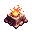

a puff of dust and pebbles bursting outward around the base of an isometric ground block, 32 px wide. A standing person in this game is 32 px tall and 16 px wide; one ground tile is a 32x16 diamond. Game spell/attack effect sprite, isometric view, glowing, bright readable colors, 32x32 canvas. pixel

### FX-12-3 · Earth ability effects for the stance rework (2026-11-22)

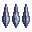

three small sharp grey metal shards side by side, each about 6 px long, pointing to the right. A standing person in this game is 32 px tall and 16 px wide; one ground tile is a 32x16 diamond. Game spell/attack effect sprite, isometric view, glowing, bright readable colors, 32x32 canvas. pixel art, i

### FX-12-4 · Earth ability effects for the stance rework (2026-11-22)

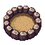

a ring of small brown-grey stones floating around an empty middle the size of a standing person. A standing person in this game is 32 px tall and 16 px wide; one ground tile is a 32x16 diamond. Game spell/attack effect sprite, isometric view, glowing, bright readable colors, 64x64 canvas. pixel art,

### FX-12-5 · Earth ability effects for the stance rework (2026-11-22)

one flat isometric ground tile, a 32x16 diamond, its edges crumbling inward as it sinks. A standing person in this game is 32 px tall and 16 px wide; one ground tile is a 32x16 diamond. Game spell/attack effect sprite, isometric view, glowing, bright readable colors, 32x32 canvas. pixel art, isometr

### FX-12-6 · Earth ability effects for the stance rework (2026-11-22)

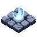

grey metallic glints and small bending creak lines around a space the size of a standing person. A standing person in this game is 32 px tall and 16 px wide; one ground tile is a 32x16 diamond. Game spell/attack effect sprite, isometric view, glowing, bright readable colors, 64x64 canvas. pixel art,

### FX-12-7 · Earth ability effects for the stance rework (2026-11-22)

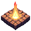

a translucent amber glow of stone light around an empty middle the size of a standing person. A standing person in this game is 32 px tall and 16 px wide; one ground tile is a 32x16 diamond. Game spell/attack effect sprite, isometric view, glowing, bright readable colors, 64x64 canvas. pixel art, is

### FX-12-8 · Earth ability effects for the stance rework (2026-11-22)

faint rings of ground ripples spreading out from the middle, a wide isometric ellipse. A standing person in this game is 32 px tall and 16 px wide; one ground tile is a 32x16 diamond. Game spell/attack effect sprite, isometric view, glowing, bright readable colors, 64x64 canvas. pixel art, isometric

### FX-12-9 · Earth ability effects for the stance rework (2026-11-22)

a steel hook at the tip of a thin metal cable; the cable runs from the left edge to the hook near the right edge. A standing person in this game is 32 px tall and 16 px wide; one ground tile is a 32x16 diamond. Game spell/attack effect sprite, isometric view, glowing, bright readable colors, 64x32 c

### FX-12-10 · Earth ability effects for the stance rework (2026-11-22)

a single large rough brown-grey boulder about 20 px wide, centred, alone, no ground or shadow. A standing person in this game is 32 px tall and 16 px wide; one ground tile is a 32x16 diamond. Game spell/attack effect sprite, isometric view, glowing, bright readable colors, 64x64 canvas. pixel art, i

### FX-12-11 · Earth ability effects for the stance rework (2026-11-22)

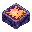

one flat isometric ground tile, a 32x16 diamond, of glowing molten lava with a darker cooled crust at the edges. A standing person in this game is 32 px tall and 16 px wide; one ground tile is a 32x16 diamond. Game spell/attack effect sprite, isometric view, glowing, bright readable colors, 32x32 ca

### FX-12-12 · Earth ability effects for the stance rework (2026-11-22)

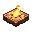

one flat isometric ground tile, a 32x16 diamond, cracked open with dust rising from the cracks. A standing person in this game is 32 px tall and 16 px wide; one ground tile is a 32x16 diamond. Game spell/attack effect sprite, isometric view, glowing, bright readable colors, 32x32 canvas. pixel art, 

### FX-12-13 · Earth ability effects for the stance rework (2026-11-22)

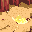

one isometric ground tile area filled with swirling semi-transparent tan sand and dust. A standing person in this game is 32 px tall and 16 px wide; one ground tile is a 32x16 diamond. Game spell/attack effect sprite, isometric view, glowing, bright readable colors, 32x32 canvas. pixel art, isometri

### FX-13-1 · Water ability effects for the stance rework (2026-11-22)

a small glowing teal ball of water about 10 px wide with white highlights, in the middle of the canvas. A standing person in this game is 32 px tall and 16 px wide; one ground tile is a 32x16 diamond. Game spell/attack effect sprite, isometric view, glowing, bright readable colors, 32x32 canvas. pix

### FX-13-2 · Water ability effects for the stance rework (2026-11-22)

ribbons of glowing teal water spiralling upward around a space the size of a standing person. A standing person in this game is 32 px tall and 16 px wide; one ground tile is a 32x16 diamond. Game spell/attack effect sprite, isometric view, glowing, bright readable colors, 64x64 canvas. pixel art, is

### FX-13-3 · Water ability effects for the stance rework (2026-11-22)

a round, see-through bubble of clear blue water just big enough to hold a standing person, white highlights. A standing person in this game is 32 px tall and 16 px wide; one ground tile is a 32x16 diamond. Game spell/attack effect sprite, isometric view, glowing, bright readable colors, 64x64 canvas

### FX-13-4 · Water ability effects for the stance rework (2026-11-22)

a small sharp shard of pale blue ice about 10 px long, pointing to the right. A standing person in this game is 32 px tall and 16 px wide; one ground tile is a 32x16 diamond. Game spell/attack effect sprite, isometric view, glowing, bright readable colors, 32x32 canvas. pixel art, isometric 2:1 view

### FX-13-5 · Water ability effects for the stance rework (2026-11-22)

soft drifting teal mist around a space the size of a standing person, with tiny sparkles. A standing person in this game is 32 px tall and 16 px wide; one ground tile is a 32x16 diamond. Game spell/attack effect sprite, isometric view, glowing, bright readable colors, 64x64 canvas. pixel art, isomet

### FX-13-6 · Water ability effects for the stance rework (2026-11-22)

a thin tendril of dark-blue water stretching from the right edge to the left edge with droplets flowing along it to the left. A standing person in this game is 32 px tall and 16 px wide; one ground tile is a 32x16 diamond. Game spell/attack effect sprite, isometric view, glowing, bright readable col

### FX-13-7 · Water ability effects for the stance rework (2026-11-22)

a ring of small glowing blue-white water droplets around the middle of a space the size of a standing person. A standing person in this game is 32 px tall and 16 px wide; one ground tile is a 32x16 diamond. Game spell/attack effect sprite, isometric view, glowing, bright readable colors, 64x64 canva

### FX-13-8 · Water ability effects for the stance rework (2026-11-22)

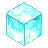

a block of clear pale-blue ice the size of a standing person, frosted edges, hollow inside. A standing person in this game is 32 px tall and 16 px wide; one ground tile is a 32x16 diamond. Game spell/attack effect sprite, isometric view, glowing, bright readable colors, 48x48 canvas. pixel art, isom

### FX-13-9 · Water ability effects for the stance rework (2026-11-22)

a column of light-blue water and soft light rising from the ground, about as tall as a standing person. A standing person in this game is 32 px tall and 16 px wide; one ground tile is a 32x16 diamond. Game spell/attack effect sprite, isometric view, glowing, bright readable colors, 64x64 canvas. pix

### FX-13-10 · Water ability effects for the stance rework (2026-11-22)

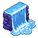

a curved wall of blue water about 16 px tall moving to the right, foam on top. A standing person in this game is 32 px tall and 16 px wide; one ground tile is a 32x16 diamond. Game spell/attack effect sprite, isometric view, glowing, bright readable colors, 64x64 canvas. pixel art, isometric 2:1 vie

### FX-13-11 · Water ability effects for the stance rework (2026-11-22)

quick swirling streams of water around the lower legs of a standing person, the middle empty. A standing person in this game is 32 px tall and 16 px wide; one ground tile is a 32x16 diamond. Game spell/attack effect sprite, isometric view, glowing, bright readable colors, 32x32 canvas. pixel art, is

### FX-13-12 · Water ability effects for the stance rework (2026-11-22)

one block of rough pale-blue ice the width of one ground tile and about 24 px tall, frosted edges. A standing person in this game is 32 px tall and 16 px wide; one ground tile is a 32x16 diamond. Game spell/attack effect sprite, isometric view, glowing, bright readable colors, 32x48 canvas. pixel ar

### FX-13-13 · Water ability effects for the stance rework (2026-11-22)

a bright glowing ribbon of white-blue spirit water winding around a space the size of a standing person. A standing person in this game is 32 px tall and 16 px wide; one ground tile is a 32x16 diamond. Game spell/attack effect sprite, isometric view, glowing, bright readable colors, 64x64 canvas. pi

### FX-13-14 · Water ability effects for the stance rework (2026-11-22)

a thin straight band of high-pressure blue water from the left edge to the right edge, about 6 px thick, spray at the edges. A standing person in this game is 32 px tall and 16 px wide; one ground tile is a 32x16 diamond. Game spell/attack effect sprite, isometric view, glowing, bright readable colo

### FX-13-15 · Water ability effects for the stance rework (2026-11-22)

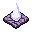

one flat isometric ground tile, a 32x16 diamond, covered in thick white steam rising. A standing person in this game is 32 px tall and 16 px wide; one ground tile is a 32x16 diamond. Game spell/attack effect sprite, isometric view, glowing, bright readable colors, 32x32 canvas. pixel art, isometric 

### FX-13-16 · Water ability effects for the stance rework (2026-11-22)

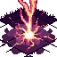

faint dark-red glowing threads wrapping around a space the size of a standing person, no blood. A standing person in this game is 32 px tall and 16 px wide; one ground tile is a 32x16 diamond. Game spell/attack effect sprite, isometric view, glowing, bright readable colors, 64x64 canvas. pixel art, 

### FX-13-17 · Water ability effects for the stance rework (2026-11-22)

one flat isometric ground tile, a 32x16 diamond, with glowing teal raindrops falling onto it. A standing person in this game is 32 px tall and 16 px wide; one ground tile is a 32x16 diamond. Game spell/attack effect sprite, isometric view, glowing, bright readable colors, 32x48 canvas. pixel art, is

### FX-13-18 · Water ability effects for the stance rework (2026-11-22)

a big curling wave of blue water with white foam, moving to the right, about 40 px tall. A standing person in this game is 32 px tall and 16 px wide; one ground tile is a 32x16 diamond. Game spell/attack effect sprite, isometric view, glowing, bright readable colors, 64x64 canvas. pixel art, isometr

### FX-13-19 · Water ability effects for the stance rework (2026-11-22)

a ring of rising water with golden sparkles around a space the size of a standing person. A standing person in this game is 32 px tall and 16 px wide; one ground tile is a 32x16 diamond. Game spell/attack effect sprite, isometric view, glowing, bright readable colors, 64x64 canvas. pixel art, isomet

### FX-13-20 · Water ability effects for the stance rework (2026-11-22)

a cluster of sharp pale-blue ice spikes on one isometric ground tile. A standing person in this game is 32 px tall and 16 px wide; one ground tile is a 32x16 diamond. Game spell/attack effect sprite, isometric view, glowing, bright readable colors, 32x48 canvas. pixel art, isometric 2:1 view, no dar

### FX-13-21 · Water ability effects for the stance rework (2026-11-22)

eight arms of clear blue water rising around an empty middle where a standing person would be, like an octopus, curling at the tips. A standing person in this game is 32 px tall and 16 px wide; one ground tile is a 32x16 diamond. Game spell/attack effect sprite, isometric view, glowing, bright reada

### FX-14-1 · Air ability effects for the stance rework (2026-11-22)

a thin crescent of white wind about 14 px long, curved like a blade, pointing to the right, semi-transparent. A standing person in this game is 32 px tall and 16 px wide; one ground tile is a 32x16 diamond. Game spell/attack effect sprite, isometric view, glowing, bright readable colors, 32x32 canva

### FX-14-2 · Air ability effects for the stance rework (2026-11-22)

a small puff of white air on the ground, about 10 px wide. A standing person in this game is 32 px tall and 16 px wide; one ground tile is a 32x16 diamond. Game spell/attack effect sprite, isometric view, glowing, bright readable colors, 32x32 canvas. pixel art, isometric 2:1 view, no dark outline, 

### FX-14-3 · Air ability effects for the stance rework (2026-11-22)

a band of swirling semi-transparent wind around the lower legs of a standing person, the middle empty. A standing person in this game is 32 px tall and 16 px wide; one ground tile is a 32x16 diamond. Game spell/attack effect sprite, isometric view, glowing, bright readable colors, 32x32 canvas. pixe

### FX-14-4 · Air ability effects for the stance rework (2026-11-22)

thin wisps of pale air drawn out from a point at the right toward the left. A standing person in this game is 32 px tall and 16 px wide; one ground tile is a 32x16 diamond. Game spell/attack effect sprite, isometric view, glowing, bright readable colors, 32x32 canvas. pixel art, isometric 2:1 view, 

### FX-14-5 · Air ability effects for the stance rework (2026-11-22)

a small spinning ball of semi-transparent white air about 16 px wide, in the middle of the canvas. A standing person in this game is 32 px tall and 16 px wide; one ground tile is a 32x16 diamond. Game spell/attack effect sprite, isometric view, glowing, bright readable colors, 32x32 canvas. pixel ar

### FX-14-6 · Air ability effects for the stance rework (2026-11-22)

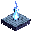

one isometric ground tile area of dark grey-blue swirling wind with streaks of rain. A standing person in this game is 32 px tall and 16 px wide; one ground tile is a 32x16 diamond. Game spell/attack effect sprite, isometric view, glowing, bright readable colors, 32x32 canvas. pixel art, isometric 2

### FX-14-7 · Air ability effects for the stance rework (2026-11-22)

a strong straight blast of white wind, wider than a palm, pointing to the right, semi-transparent. A standing person in this game is 32 px tall and 16 px wide; one ground tile is a 32x16 diamond. Game spell/attack effect sprite, isometric view, glowing, bright readable colors, 64x64 canvas. pixel ar

### FX-14-8 · Air ability effects for the stance rework (2026-11-22)

a translucent bubble of swirling air just big enough to hold a standing person. A standing person in this game is 32 px tall and 16 px wide; one ground tile is a 32x16 diamond. Game spell/attack effect sprite, isometric view, glowing, bright readable colors, 64x64 canvas. pixel art, isometric 2:1 vi

### FX-14-9 · Air ability effects for the stance rework (2026-11-22)

a burst of white wind swirls, as if someone vanished in a gust. A standing person in this game is 32 px tall and 16 px wide; one ground tile is a 32x16 diamond. Game spell/attack effect sprite, isometric view, glowing, bright readable colors, 64x64 canvas. pixel art, isometric 2:1 view, no dark outl

### FX-14-10 · Air ability effects for the stance rework (2026-11-22)

a flat inward-spiralling swirl of wind on the ground, an isometric ellipse about 56 px wide. A standing person in this game is 32 px tall and 16 px wide; one ground tile is a 32x16 diamond. Game spell/attack effect sprite, isometric view, glowing, bright readable colors, 64x64 canvas. pixel art, iso

### FX-14-11 · Air ability effects for the stance rework (2026-11-22)

a tall narrow column of upward-rushing white wind, about 16 px wide. A standing person in this game is 32 px tall and 16 px wide; one ground tile is a 32x16 diamond. Game spell/attack effect sprite, isometric view, glowing, bright readable colors, 32x64 canvas. pixel art, isometric 2:1 view, no dark

### FX-14-12 · Air ability effects for the stance rework (2026-11-22)

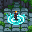

a tight ring of swirling pale air at head height of a standing person, the middle empty. A standing person in this game is 32 px tall and 16 px wide; one ground tile is a 32x16 diamond. Game spell/attack effect sprite, isometric view, glowing, bright readable colors, 32x32 canvas. pixel art, isometr

### FX-14-13 · Air ability effects for the stance rework (2026-11-22)

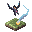

streams of pale wind trailing under a flying person, short and curling. A standing person in this game is 32 px tall and 16 px wide; one ground tile is a 32x16 diamond. Game spell/attack effect sprite, isometric view, glowing, bright readable colors, 32x32 canvas. pixel art, isometric 2:1 view, no d

### FX-14-14 · Air ability effects for the stance rework (2026-11-22)

a small grey-white tornado about 16 px wide and 40 px tall, with bits of debris. A standing person in this game is 32 px tall and 16 px wide; one ground tile is a 32x16 diamond. Game spell/attack effect sprite, isometric view, glowing, bright readable colors, 32x64 canvas. pixel art, isometric 2:1 v

### FX-14-15 · Air ability effects for the stance rework (2026-11-22)

a ring of swirling white wind around an empty middle, an isometric ellipse about 48 px wide. A standing person in this game is 32 px tall and 16 px wide; one ground tile is a 32x16 diamond. Game spell/attack effect sprite, isometric view, glowing, bright readable colors, 64x64 canvas. pixel art, iso

### FX-14-16 · Air ability effects for the stance rework (2026-11-22)

a flat ring of compressed air pressing down on the ground around an empty middle, faint pressure lines. A standing person in this game is 32 px tall and 16 px wide; one ground tile is a 32x16 diamond. Game spell/attack effect sprite, isometric view, glowing, bright readable colors, 64x64 canvas. pix

### FX-14-17 · Air ability effects for the stance rework (2026-11-22)

a few faint white feathers and wisps of air floating around a space the size of a standing person. A standing person in this game is 32 px tall and 16 px wide; one ground tile is a 32x16 diamond. Game spell/attack effect sprite, isometric view, glowing, bright readable colors, 64x64 canvas. pixel ar

### FX-14-18 · Air ability effects for the stance rework (2026-11-22)

one isometric ground tile area of fierce dark swirling storm wind with debris. A standing person in this game is 32 px tall and 16 px wide; one ground tile is a 32x16 diamond. Game spell/attack effect sprite, isometric view, glowing, bright readable colors, 32x32 canvas. pixel art, isometric 2:1 vie

### FX-15-1 · Stance auras (loops around the hero while a stance is held) (2026-11-22)

small embers and flickers drifting up around a standing person, drawn around an empty middle where a standing person would be, so it can sit around the hero; the middle stays empty. A standing person in this game is 32 px tall and 16 px wide; one ground tile is a 32x16 diamond. Game spell/attack eff

### FX-15-2 · Stance auras (loops around the hero while a stance is held) (2026-11-22)

two thin ribbons of flame circling around the arms' height of a standing person, drawn around an empty middle where a standing person would be, so it can sit around the hero; the middle stays empty. A standing person in this game is 32 px tall and 16 px wide; one ground tile is a 32x16 diamond. Game

### FX-15-3 · Stance auras (loops around the hero while a stance is held) (2026-11-22)

small jets of flame flickering at the feet of a standing person, drawn around an empty middle where a standing person would be, so it can sit around the hero; the middle stays empty. A standing person in this game is 32 px tall and 16 px wide; one ground tile is a 32x16 diamond. Game spell/attack ef

### FX-15-4 · Stance auras (loops around the hero while a stance is held) (2026-11-22)

a small glowing sun above the head of a standing person with sparks crackling below it, drawn around an empty middle where a standing person would be, so it can sit around the hero; the middle stays empty. A standing person in this game is 32 px tall and 16 px wide; one ground tile is a 32x16 diamon

### FX-15-5 · Stance auras (loops around the hero while a stance is held) (2026-11-22)

a fire dragon made of flame coiling around a standing person, drawn around an empty middle where a standing person would be, so it can sit around the hero; the middle stays empty. A standing person in this game is 32 px tall and 16 px wide; one ground tile is a 32x16 diamond. Game spell/attack effec

### FX-15-6 · Stance auras (loops around the hero while a stance is held) (2026-11-22)

small stone plates orbiting close around the waist of a standing person, drawn around an empty middle where a standing person would be, so it can sit around the hero; the middle stays empty. A standing person in this game is 32 px tall and 16 px wide; one ground tile is a 32x16 diamond. Game spell/a

### FX-15-7 · Stance auras (loops around the hero while a stance is held) (2026-11-22)

faint ripples spreading in the ground around the feet of a standing person, drawn around an empty middle where a standing person would be, so it can sit around the hero; the middle stays empty. A standing person in this game is 32 px tall and 16 px wide; one ground tile is a 32x16 diamond. Game spel

### FX-15-8 · Stance auras (loops around the hero while a stance is held) (2026-11-22)

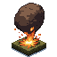

a large rough brown-grey boulder about 20 px wide hovering above where a person's head would be, pebbles falling. A standing person in this game is 32 px tall and 16 px wide; one ground tile is a 32x16 diamond. Game spell/attack effect sprite, isometric view, glowing, bright readable colors, 64x64 c

### FX-15-9 · Stance auras (loops around the hero while a stance is held) (2026-11-22)

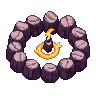

a ring of rough boulders orbiting around a standing person, drawn around an empty middle where a standing person would be, so it can sit around the hero; the middle stays empty. A standing person in this game is 32 px tall and 16 px wide; one ground tile is a 32x16 diamond. Game spell/attack effect 

### FX-15-10 · Stance auras (loops around the hero while a stance is held) (2026-11-22)

a single rope of clear blue water circling around a standing person, drawn around an empty middle where a standing person would be, so it can sit around the hero; the middle stays empty. A standing person in this game is 32 px tall and 16 px wide; one ground tile is a 32x16 diamond. Game spell/attac

### FX-15-11 · Stance auras (loops around the hero while a stance is held) (2026-11-22)

a rotating hoop of clear blue water around the waist of a standing person, drawn around an empty middle where a standing person would be, so it can sit around the hero; the middle stays empty. A standing person in this game is 32 px tall and 16 px wide; one ground tile is a 32x16 diamond. Game spell

### FX-15-12 · Stance auras (loops around the hero while a stance is held) (2026-11-22)

a single floating sphere of clear blue water about 14 px wide, white highlights, in the middle of the canvas. A standing person in this game is 32 px tall and 16 px wide; one ground tile is a 32x16 diamond. Game spell/attack effect sprite, isometric view, glowing, bright readable colors, 32x32 canva

### FX-15-13 · Stance auras (loops around the hero while a stance is held) (2026-11-22)

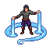

two long arms of clear blue water hanging from the shoulders of a standing person, curved at the tips, drawn around an empty middle where a standing person would be, so it can sit around the hero; the middle stays empty. A standing person in this game is 32 px tall and 16 px wide; one ground tile is

### FX-15-14 · Stance auras (loops around the hero while a stance is held) (2026-11-22)

a small swirl of pale wind circling in front of a standing person's chest, drawn around an empty middle where a standing person would be, so it can sit around the hero; the middle stays empty. A standing person in this game is 32 px tall and 16 px wide; one ground tile is a 32x16 diamond. Game spell

### FX-15-15 · Stance auras (loops around the hero while a stance is held) (2026-11-22)

a spinning ring of pale air around the waist of a standing person, drawn around an empty middle where a standing person would be, so it can sit around the hero; the middle stays empty. A standing person in this game is 32 px tall and 16 px wide; one ground tile is a 32x16 diamond. Game spell/attack 

### FX-15-16 · Stance auras (loops around the hero while a stance is held) (2026-11-22)

two small cyclones of pale wind wrapped around the arms of a standing person, drawn around an empty middle where a standing person would be, so it can sit around the hero; the middle stays empty. A standing person in this game is 32 px tall and 16 px wide; one ground tile is a 32x16 diamond. Game sp

### FX-15-17 · Stance auras (loops around the hero while a stance is held) (2026-11-22)

a column of pale wind rising around a standing person, drawn around an empty middle where a standing person would be, so it can sit around the hero; the middle stays empty. A standing person in this game is 32 px tall and 16 px wide; one ground tile is a 32x16 diamond. Game spell/attack effect sprit

### PL-01-1+fire-stance-2-settles-into-a-firebending · Hero base body (2026-11-22)

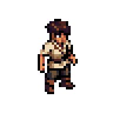

Made from approved/PL-01-1.png: fire stance 2: settles into a firebending stance and swings both forearms in slow circles as if trailing ribbons of flame, ending guarded with fists up

### PL-01-1+fire-stance-3-drops-into-a-low-springy-c · Hero base body (2026-11-22)

Made from approved/PL-01-1.png: fire stance 3: drops into a low springy crouch on the balls of the feet, heels lifted, arms swept back, ready to dash

### PL-01-1+fire-stance-4-presses-the-palms-together · Hero base body (2026-11-22)

Made from approved/PL-01-1.png: fire stance 4: presses the palms together at the chest, raises them overhead as if lifting a small sun, then points two fingers forward

### PL-01-1+fire-stance-5-sweeps-both-arms-in-a-wide · Hero base body (2026-11-22)

Made from approved/PL-01-1.png: fire stance 5: sweeps both arms in a wide circle around the body as if a fire dragon coils around it, ending in a wide stance with arms spread

### PL-01-1+earth-stance-2-plants-the-feet-and-slams · Hero base body (2026-11-22)

Made from approved/PL-01-1.png: earth stance 2: plants the feet and slams both forearms together in front of the chest, ending with fists raised in a heavy guard

### PL-01-1+earth-stance-3-steps-into-a-very-wide-lo · Hero base body (2026-11-22)

Made from approved/PL-01-1.png: earth stance 3: steps into a very wide low barefoot stance and presses one palm toward the ground, head tilted as if listening to it

### PL-01-1+earth-stance-4-lifts-both-arms-high-over · Hero base body (2026-11-22)

Made from approved/PL-01-1.png: earth stance 4: lifts both arms high overhead with straining effort as if holding a huge boulder above the head, and holds it there

### PL-01-1+earth-stance-5-spreads-both-arms-wide-an · Hero base body (2026-11-22)

Made from approved/PL-01-1.png: earth stance 5: spreads both arms wide and turns slowly in place as if raising a ring of boulders around the body, ending feet wide

### PL-01-1+water-stance-1-one-hand-draws-up-from-th · Hero base body (2026-11-22)

Made from approved/PL-01-1.png: water stance 1: one hand draws up from the hip and circles once overhead as if pulling a rope of water around the body, ending relaxed

### PL-01-1+water-stance-2-both-hands-trace-a-large- · Hero base body (2026-11-22)

Made from approved/PL-01-1.png: water stance 2: both hands trace a large circle around the waist as if spinning a hoop of water around the body, knees softly bent

### PL-01-1+water-stance-3-both-hands-gather-in-fron · Hero base body (2026-11-22)

Made from approved/PL-01-1.png: water stance 3: both hands gather in front of the chest as if cradling a floating sphere of water, rocking gently forward

### PL-01-1+water-stance-4-both-arms-swing-up-and-ou · Hero base body (2026-11-22)

Made from approved/PL-01-1.png: water stance 4: both arms swing up and outward, then hang heavy and curved at the sides as if wrapped in long arms of water

### PL-01-1+water-stance-5-raises-both-arms-high-and · Hero base body (2026-11-22)

Made from approved/PL-01-1.png: water stance 5: raises both arms high and lets them sway like tentacles, ending in a wide swaying stance (octopus form)

### PL-01-1+air-stance-1-light-hop-onto-the-balls-of · Hero base body (2026-11-22)

Made from approved/PL-01-1.png: air stance 1: light hop onto the balls of the feet, one open palm circles in front of the chest as if stirring a small swirl of wind

### PL-01-1+air-stance-2-turns-once-on-the-spot-with · Hero base body (2026-11-22)

Made from approved/PL-01-1.png: air stance 2: turns once on the spot with both hands sweeping around the waist as if spinning a ring of air, ending light-footed

### PL-01-1+air-stance-3-hops-up-and-lands-balanced- · Hero base body (2026-11-22)

Made from approved/PL-01-1.png: air stance 3: hops up and lands balanced on one foot as if standing on a small ball of air, arms out for balance

### PL-01-1+air-stance-4-both-arms-whirl-in-fast-cir · Hero base body (2026-11-22)

Made from approved/PL-01-1.png: air stance 4: both arms whirl in fast circles at the sides as if wrapped in small cyclones, ending with palms forward

### PL-01-1+air-stance-5-raises-both-arms-straight-u · Hero base body (2026-11-22)

Made from approved/PL-01-1.png: air stance 5: raises both arms straight up and spins slowly as if a column of wind rises around the body, clothes lifting

### PL-01-1+bending-push-thrusts-both-open-palms-str · Hero base body (2026-11-22)

Made from approved/PL-01-1.png: bending push: thrusts both open palms straight forward from the chest in a short sharp push, then recovers

### PL-01-1+bending-channel-holds-both-palms-forward · Hero base body (2026-11-22)

Made from approved/PL-01-1.png: bending channel: holds both palms forward with the body braced and shaking slightly as if pushing out a strong stream, then releases

### PL-01-1+bending-overhead-slam-raises-both-arms-h · Hero base body (2026-11-22)

Made from approved/PL-01-1.png: bending overhead slam: raises both arms high overhead, then brings both down hard toward the ground in front, knees bending with the impact

### PL-01-1+bending-ground-press-crouches-and-presse · Hero base body (2026-11-22)

Made from approved/PL-01-1.png: bending ground press: crouches and presses both palms flat down toward the ground, then rises

### PL-01-1+bending-breath-inhales-deeply-with-the-c · Hero base body (2026-11-22)

Made from approved/PL-01-1.png: bending breath: inhales deeply with the chest rising, then leans forward and exhales hard with both hands framing the mouth

### PL-01-1+lightning-bending-two-fingers-trace-a-qu · Hero base body (2026-11-22)

Made from approved/PL-01-1.png: lightning bending: two fingers trace a quick circle at the side, then the arm thrusts forward with two fingers pointed

### PL-01-1+combustion-focus-brings-both-hands-up-be · Hero base body (2026-11-22)

Made from approved/PL-01-1.png: combustion focus: brings both hands up beside the forehead, leans forward and snaps the head forward as if firing a blast from the brow

### PL-01-1+bending-spin-attack-spins-a-full-turn-wi · Hero base body (2026-11-22)

Made from approved/PL-01-1.png: bending spin attack: spins a full turn with one leg kicked out at waist height, then lands back in stance

### PL-01-1+bending-leap-strike-jumps-forward-and-up · Hero base body (2026-11-22)

Made from approved/PL-01-1.png: bending leap strike: jumps forward and up, then crashes down with a downward kick, landing in a deep crouch

### PL-01-1+bending-dash-crouches-and-bursts-forward · Hero base body (2026-11-22)

Made from approved/PL-01-1.png: bending dash: crouches and bursts forward in a fast, low dash, ending in a short skid

### PL-01-1+bending-flight-airborne-loop-the-body-le · Hero base body (2026-11-22)

Made from approved/PL-01-1.png: bending flight: airborne loop, the body leaning forward in the air, legs together, arms swept back, gently bobbing

### PL-01-1+air-scooter-ride-loop-of-crouching-and-b · Hero base body (2026-11-22)

Made from approved/PL-01-1.png: air scooter ride: loop of crouching and balancing on a small spinning ball of air under the feet, arms out

### PL-01-1+bending-blessing-a-gentle-two-handed-ges · Hero base body (2026-11-22)

Made from approved/PL-01-1.png: bending blessing: a gentle two-handed gesture, palms lifting from low to high toward someone in front, calm and graceful

### PL-01-1+bending-revive-kneels-on-one-knee-and-sl · Hero base body (2026-11-22)

Made from approved/PL-01-1.png: bending revive: kneels on one knee and slowly lifts both palms from the ground upward as if raising someone

### PL-01-1+bending-control-both-hands-clawed-and-tw · Hero base body (2026-11-22)

Made from approved/PL-01-1.png: bending control: both hands clawed and twisting slowly as if pulling invisible strings, body tense and leaning forward

### PL-01-1+bending-taunt-stomps-forward-with-the-ch · Hero base body (2026-11-22)

Made from approved/PL-01-1.png: bending taunt: stomps forward with the chest out and both arms flung wide in a shout

### PL-01-1+bending-storm-call-both-arms-circle-over · Hero base body (2026-11-22)

Made from approved/PL-01-1.png: bending storm call: both arms circle overhead faster and faster, then thrust straight up

### PL-01-3 · Hero base body (2026-11-21) ✓ approved

 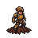

Made from approved/PL-01-1.png: standing in a deep, wide rooted earthbending stance, the whole body covered in grey-brown stone plates like cracked river-stone armour, thin glowing amber seams between the plates

### FX-07-1 · Ability effects for the animation rework (rock, stone, water, air, fire) (2026-11-21) ✓ approved

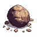

a rough brown-grey boulder about 12 px wide floating in the middle of the canvas, small pebbles and dust falling from its underside. Game spell/attack effect sprite, isometric view, glowing, bright readable colors, 64x64 canvas. pixel art, isometric 2:1 view, no dark outline, limited palette, soft l

### FX-07-2 · Ability effects for the animation rework (rock, stone, water, air, fire) (2026-11-21)

a long ribbon of clear blue water lashing from the left edge toward the right in a curving S shape, a spray of droplets at the tip. Game spell/attack effect sprite, isometric view, glowing, bright readable colors, 64x64 canvas. pixel art, isometric 2:1 view, no dark outline, limited palette, soft li

### FX-07-3 · Ability effects for the animation rework (rock, stone, water, air, fire) (2026-11-21)

a small glowing teal ball of water with soft white highlights, in the middle of the canvas. Game spell/attack effect sprite, isometric view, glowing, bright readable colors, 32x32 canvas. pixel art, isometric 2:1 view, no dark outline, limited palette, soft light from top-left, transparent backgroun

### FX-07-4 · Ability effects for the animation rework (rock, stone, water, air, fire) (2026-11-21)

ribbons of glowing teal water spiralling upward in a column as tall as a standing person, with green-blue sparkles. Game spell/attack effect sprite, isometric view, glowing, bright readable colors, 64x64 canvas. pixel art, isometric 2:1 view, no dark outline, limited palette, soft light from top-lef

### FX-07-5 · Ability effects for the animation rework (rock, stone, water, air, fire) (2026-11-21)

a palm-shaped puff of pale white-blue wind with curved swirl lines, pointing to the right. Game spell/attack effect sprite, isometric view, glowing, bright readable colors, 64x64 canvas. pixel art, isometric 2:1 view, no dark outline, limited palette, soft light from top-left, transparent background

### FX-07-6 · Ability effects for the animation rework (rock, stone, water, air, fire) (2026-11-21)

a wide cone of pale white-blue wind streaks carrying small leaves and dust, spreading from the left edge toward the right. Game spell/attack effect sprite, isometric view, glowing, bright readable colors, 64x64 canvas. pixel art, isometric 2:1 view, no dark outline, limited palette, soft light from 

### FX-07-7 · Ability effects for the animation rework (rock, stone, water, air, fire) (2026-11-21)

a short burst of orange and yellow fire with a bright white-hot core, blasting toward the right. Game spell/attack effect sprite, isometric view, glowing, bright readable colors, 64x64 canvas. pixel art, isometric 2:1 view, no dark outline, limited palette, soft light from top-left, transparent back

### FX-07-8 · Ability effects for the animation rework (rock, stone, water, air, fire) (2026-11-21)

a crescent-shaped arc of orange and yellow flame, bright at its leading edge, trailing embers. Game spell/attack effect sprite, isometric view, glowing, bright readable colors, 64x64 canvas. pixel art, isometric 2:1 view, no dark outline, limited palette, soft light from top-left, transparent backgr

### PL-01-1+earthbending-root-drops-into-a-very-wide · Hero base body (2026-11-21)

Made from approved/PL-01-1.png: earthbending root: drops into a very wide, low horse stance, stomps one foot down, then lifts both palms up from the hips as if raising a heavy rock, ending with fists at chest height

### PL-01-1+earthbending-hold-keeps-a-deep-wide-hors · Hero base body (2026-11-21)

Made from approved/PL-01-1.png: earthbending hold: keeps a deep, wide horse stance with fists at chest height, straining slightly, feet planted, subtle breathing

### PL-01-1+earthbending-punch-from-a-wide-rooted-ho · Hero base body (2026-11-21)

Made from approved/PL-01-1.png: earthbending punch: from a wide rooted horse stance, throws one powerful straight punch forward, twisting the torso, feet stay planted

### PL-01-1+stone-skin-in-a-wide-rooted-stance-grey- · Hero base body (2026-11-21)

Made from approved/PL-01-1.png: stone skin: in a wide rooted stance, grey-brown stone plates grow up from the feet and cover the whole body like stone armour

### PL-01-1+waterbending-heal-one-hand-sweeps-low-an · Hero base body (2026-11-21)

Made from approved/PL-01-1.png: waterbending heal: one hand sweeps low and draws upward, both hands circle slowly in front of the chest, then push gently forward with open palms

### PL-01-1+waterbending-whip-quick-pull-back-of-one · Hero base body (2026-11-21)

Made from approved/PL-01-1.png: waterbending whip: quick pull back of one arm, then a sharp sideways crack of the wrist and arm like snapping a whip, brief recovery

### PL-01-1+airbending-palm-light-step-forward-thrus · Hero base body (2026-11-21)

Made from approved/PL-01-1.png: airbending palm: light step forward, thrusts one open palm straight out at chest height, back arm swings back for balance

### PL-01-1+airbending-gust-winds-both-arms-to-one-s · Hero base body (2026-11-21)

Made from approved/PL-01-1.png: airbending gust: winds both arms to one side, then sweeps both hands across the body in a wide horizontal arc, clothes flaring

### PL-01-1+firebending-punch-very-fast-straight-jab · Hero base body (2026-11-21)

Made from approved/PL-01-1.png: firebending punch: very fast straight jab from a fighting stance, no wind-up, full extension then snapping back

### PL-01-1+firebending-kick-fast-roundhouse-kick-at · Hero base body (2026-11-21)

Made from approved/PL-01-1.png: firebending kick: fast roundhouse kick at waist height, the leg whips around, full extension, then the foot returns to the ground

### PL-01-1+earthbending-root-drops-into-a-very-wide@east · Hero base body (2026-11-21)

Made from approved/PL-01-1.png: earthbending root: drops into a very wide, low horse stance, stomps one foot down, then lifts both palms up from the hips as if raising a heavy rock, ending with fists at chest height

### PL-01-1+earthbending-root-drops-into-a-very-wide@north-east · Hero base body (2026-11-21)

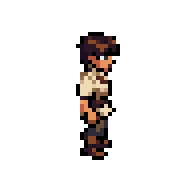

Made from approved/PL-01-1.png: earthbending root: drops into a very wide, low horse stance, stomps one foot down, then lifts both palms up from the hips as if raising a heavy rock, ending with fists at chest height

### PL-01-1+earthbending-root-drops-into-a-very-wide@north · Hero base body (2026-11-21)

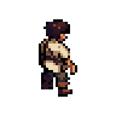

Made from approved/PL-01-1.png: earthbending root: drops into a very wide, low horse stance, stomps one foot down, then lifts both palms up from the hips as if raising a heavy rock, ending with fists at chest height

### PL-01-1+earthbending-root-drops-into-a-very-wide@north-west · Hero base body (2026-11-21)

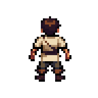

Made from approved/PL-01-1.png: earthbending root: drops into a very wide, low horse stance, stomps one foot down, then lifts both palms up from the hips as if raising a heavy rock, ending with fists at chest height

### PL-01-1+earthbending-root-drops-into-a-very-wide@west · Hero base body (2026-11-21)

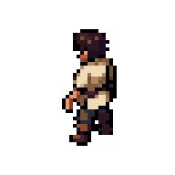

Made from approved/PL-01-1.png: earthbending root: drops into a very wide, low horse stance, stomps one foot down, then lifts both palms up from the hips as if raising a heavy rock, ending with fists at chest height

### PL-01-1+earthbending-root-drops-into-a-very-wide@south-west · Hero base body (2026-11-21)

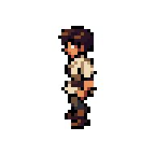

Made from approved/PL-01-1.png: earthbending root: drops into a very wide, low horse stance, stomps one foot down, then lifts both palms up from the hips as if raising a heavy rock, ending with fists at chest height

### PL-01-1+earthbending-root-drops-into-a-very-wide@south · Hero base body (2026-11-21)

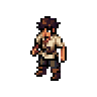

Made from approved/PL-01-1.png: earthbending root: drops into a very wide, low horse stance, stomps one foot down, then lifts both palms up from the hips as if raising a heavy rock, ending with fists at chest height

### PL-01-1+earthbending-hold-keeps-a-deep-wide-hors@east · Hero base body (2026-11-21)

Made from approved/PL-01-1.png: earthbending hold: keeps a deep, wide horse stance with fists at chest height, straining slightly, feet planted, subtle breathing

### PL-01-1+earthbending-hold-keeps-a-deep-wide-hors@north-east · Hero base body (2026-11-21)

Made from approved/PL-01-1.png: earthbending hold: keeps a deep, wide horse stance with fists at chest height, straining slightly, feet planted, subtle breathing

### PL-01-1+earthbending-hold-keeps-a-deep-wide-hors@north · Hero base body (2026-11-21)

Made from approved/PL-01-1.png: earthbending hold: keeps a deep, wide horse stance with fists at chest height, straining slightly, feet planted, subtle breathing

### PL-01-1+earthbending-hold-keeps-a-deep-wide-hors@north-west · Hero base body (2026-11-21)

Made from approved/PL-01-1.png: earthbending hold: keeps a deep, wide horse stance with fists at chest height, straining slightly, feet planted, subtle breathing

### PL-01-1+earthbending-hold-keeps-a-deep-wide-hors@west · Hero base body (2026-11-21)

Made from approved/PL-01-1.png: earthbending hold: keeps a deep, wide horse stance with fists at chest height, straining slightly, feet planted, subtle breathing

### PL-01-1+earthbending-hold-keeps-a-deep-wide-hors@south-west · Hero base body (2026-11-21)

Made from approved/PL-01-1.png: earthbending hold: keeps a deep, wide horse stance with fists at chest height, straining slightly, feet planted, subtle breathing

### PL-01-1+earthbending-hold-keeps-a-deep-wide-hors@south · Hero base body (2026-11-21)

Made from approved/PL-01-1.png: earthbending hold: keeps a deep, wide horse stance with fists at chest height, straining slightly, feet planted, subtle breathing

### PL-01-1+earthbending-punch-from-a-wide-rooted-ho@east · Hero base body (2026-11-21)

Made from approved/PL-01-1.png: earthbending punch: from a wide rooted horse stance, throws one powerful straight punch forward, twisting the torso, feet stay planted

### PL-01-1+earthbending-punch-from-a-wide-rooted-ho@north-east · Hero base body (2026-11-21)

Made from approved/PL-01-1.png: earthbending punch: from a wide rooted horse stance, throws one powerful straight punch forward, twisting the torso, feet stay planted

### PL-01-1+earthbending-punch-from-a-wide-rooted-ho@north · Hero base body (2026-11-21)

Made from approved/PL-01-1.png: earthbending punch: from a wide rooted horse stance, throws one powerful straight punch forward, twisting the torso, feet stay planted

### PL-01-1+earthbending-punch-from-a-wide-rooted-ho@north-west · Hero base body (2026-11-21)

Made from approved/PL-01-1.png: earthbending punch: from a wide rooted horse stance, throws one powerful straight punch forward, twisting the torso, feet stay planted

### PL-01-1+earthbending-punch-from-a-wide-rooted-ho@west · Hero base body (2026-11-21)

Made from approved/PL-01-1.png: earthbending punch: from a wide rooted horse stance, throws one powerful straight punch forward, twisting the torso, feet stay planted

### PL-01-1+earthbending-punch-from-a-wide-rooted-ho@south-west · Hero base body (2026-11-21)

Made from approved/PL-01-1.png: earthbending punch: from a wide rooted horse stance, throws one powerful straight punch forward, twisting the torso, feet stay planted

### PL-01-1+earthbending-punch-from-a-wide-rooted-ho@south · Hero base body (2026-11-21)

Made from approved/PL-01-1.png: earthbending punch: from a wide rooted horse stance, throws one powerful straight punch forward, twisting the torso, feet stay planted

### PL-01-1+stone-skin-in-a-wide-rooted-stance-grey-@east · Hero base body (2026-11-21)

Made from approved/PL-01-1.png: stone skin: in a wide rooted stance, grey-brown stone plates grow up from the feet and cover the whole body like stone armour

### PL-01-1+stone-skin-in-a-wide-rooted-stance-grey-@north-east · Hero base body (2026-11-21)

Made from approved/PL-01-1.png: stone skin: in a wide rooted stance, grey-brown stone plates grow up from the feet and cover the whole body like stone armour

### PL-01-1+stone-skin-in-a-wide-rooted-stance-grey-@north · Hero base body (2026-11-21)

Made from approved/PL-01-1.png: stone skin: in a wide rooted stance, grey-brown stone plates grow up from the feet and cover the whole body like stone armour

### PL-01-1+stone-skin-in-a-wide-rooted-stance-grey-@north-west · Hero base body (2026-11-21)

Made from approved/PL-01-1.png: stone skin: in a wide rooted stance, grey-brown stone plates grow up from the feet and cover the whole body like stone armour

### PL-01-1+stone-skin-in-a-wide-rooted-stance-grey-@west · Hero base body (2026-11-21)

Made from approved/PL-01-1.png: stone skin: in a wide rooted stance, grey-brown stone plates grow up from the feet and cover the whole body like stone armour

### PL-01-1+stone-skin-in-a-wide-rooted-stance-grey-@south-west · Hero base body (2026-11-21)

Made from approved/PL-01-1.png: stone skin: in a wide rooted stance, grey-brown stone plates grow up from the feet and cover the whole body like stone armour

### PL-01-1+stone-skin-in-a-wide-rooted-stance-grey-@south · Hero base body (2026-11-21)

Made from approved/PL-01-1.png: stone skin: in a wide rooted stance, grey-brown stone plates grow up from the feet and cover the whole body like stone armour

### PL-01-1+waterbending-heal-one-hand-sweeps-low-an@east · Hero base body (2026-11-21)

Made from approved/PL-01-1.png: waterbending heal: one hand sweeps low and draws upward, both hands circle slowly in front of the chest, then push gently forward with open palms

### PL-01-1+waterbending-heal-one-hand-sweeps-low-an@north-east · Hero base body (2026-11-21)

Made from approved/PL-01-1.png: waterbending heal: one hand sweeps low and draws upward, both hands circle slowly in front of the chest, then push gently forward with open palms

### PL-01-1+waterbending-heal-one-hand-sweeps-low-an@north · Hero base body (2026-11-21)

Made from approved/PL-01-1.png: waterbending heal: one hand sweeps low and draws upward, both hands circle slowly in front of the chest, then push gently forward with open palms

### PL-01-1+waterbending-heal-one-hand-sweeps-low-an@north-west · Hero base body (2026-11-21)

Made from approved/PL-01-1.png: waterbending heal: one hand sweeps low and draws upward, both hands circle slowly in front of the chest, then push gently forward with open palms

### PL-01-1+waterbending-heal-one-hand-sweeps-low-an@west · Hero base body (2026-11-21)

Made from approved/PL-01-1.png: waterbending heal: one hand sweeps low and draws upward, both hands circle slowly in front of the chest, then push gently forward with open palms

### PL-01-1+waterbending-heal-one-hand-sweeps-low-an@south-west · Hero base body (2026-11-21)

Made from approved/PL-01-1.png: waterbending heal: one hand sweeps low and draws upward, both hands circle slowly in front of the chest, then push gently forward with open palms

### PL-01-1+waterbending-heal-one-hand-sweeps-low-an@south · Hero base body (2026-11-21)

Made from approved/PL-01-1.png: waterbending heal: one hand sweeps low and draws upward, both hands circle slowly in front of the chest, then push gently forward with open palms

### PL-01-1+waterbending-whip-quick-pull-back-of-one@east · Hero base body (2026-11-21)

Made from approved/PL-01-1.png: waterbending whip: quick pull back of one arm, then a sharp sideways crack of the wrist and arm like snapping a whip, brief recovery

### PL-01-1+waterbending-whip-quick-pull-back-of-one@north-east · Hero base body (2026-11-21)

Made from approved/PL-01-1.png: waterbending whip: quick pull back of one arm, then a sharp sideways crack of the wrist and arm like snapping a whip, brief recovery

### PL-01-1+waterbending-whip-quick-pull-back-of-one@north · Hero base body (2026-11-21)

Made from approved/PL-01-1.png: waterbending whip: quick pull back of one arm, then a sharp sideways crack of the wrist and arm like snapping a whip, brief recovery

### PL-01-1+waterbending-whip-quick-pull-back-of-one@north-west · Hero base body (2026-11-21)

Made from approved/PL-01-1.png: waterbending whip: quick pull back of one arm, then a sharp sideways crack of the wrist and arm like snapping a whip, brief recovery

### PL-01-1+waterbending-whip-quick-pull-back-of-one@west · Hero base body (2026-11-21)

Made from approved/PL-01-1.png: waterbending whip: quick pull back of one arm, then a sharp sideways crack of the wrist and arm like snapping a whip, brief recovery

### PL-01-1+waterbending-whip-quick-pull-back-of-one@south-west · Hero base body (2026-11-21)

Made from approved/PL-01-1.png: waterbending whip: quick pull back of one arm, then a sharp sideways crack of the wrist and arm like snapping a whip, brief recovery

### PL-01-1+waterbending-whip-quick-pull-back-of-one@south · Hero base body (2026-11-21)

Made from approved/PL-01-1.png: waterbending whip: quick pull back of one arm, then a sharp sideways crack of the wrist and arm like snapping a whip, brief recovery

### PL-01-1+airbending-palm-light-step-forward-thrus@east · Hero base body (2026-11-21)

Made from approved/PL-01-1.png: airbending palm: light step forward, thrusts one open palm straight out at chest height, back arm swings back for balance

### PL-01-1+airbending-palm-light-step-forward-thrus@north-east · Hero base body (2026-11-21)

Made from approved/PL-01-1.png: airbending palm: light step forward, thrusts one open palm straight out at chest height, back arm swings back for balance

### PL-01-1+airbending-palm-light-step-forward-thrus@north · Hero base body (2026-11-21)

Made from approved/PL-01-1.png: airbending palm: light step forward, thrusts one open palm straight out at chest height, back arm swings back for balance

### PL-01-1+airbending-palm-light-step-forward-thrus@north-west · Hero base body (2026-11-21)

Made from approved/PL-01-1.png: airbending palm: light step forward, thrusts one open palm straight out at chest height, back arm swings back for balance

### PL-01-1+airbending-palm-light-step-forward-thrus@west · Hero base body (2026-11-21)

Made from approved/PL-01-1.png: airbending palm: light step forward, thrusts one open palm straight out at chest height, back arm swings back for balance

### PL-01-1+airbending-palm-light-step-forward-thrus@south-west · Hero base body (2026-11-21)

Made from approved/PL-01-1.png: airbending palm: light step forward, thrusts one open palm straight out at chest height, back arm swings back for balance

### PL-01-1+airbending-palm-light-step-forward-thrus@south · Hero base body (2026-11-21)

Made from approved/PL-01-1.png: airbending palm: light step forward, thrusts one open palm straight out at chest height, back arm swings back for balance

### PL-01-1+airbending-gust-winds-both-arms-to-one-s@east · Hero base body (2026-11-21)

Made from approved/PL-01-1.png: airbending gust: winds both arms to one side, then sweeps both hands across the body in a wide horizontal arc, clothes flaring

### PL-01-1+airbending-gust-winds-both-arms-to-one-s@north-east · Hero base body (2026-11-21)

Made from approved/PL-01-1.png: airbending gust: winds both arms to one side, then sweeps both hands across the body in a wide horizontal arc, clothes flaring

### PL-01-1+airbending-gust-winds-both-arms-to-one-s@north · Hero base body (2026-11-21)

Made from approved/PL-01-1.png: airbending gust: winds both arms to one side, then sweeps both hands across the body in a wide horizontal arc, clothes flaring

### PL-01-1+airbending-gust-winds-both-arms-to-one-s@north-west · Hero base body (2026-11-21)

Made from approved/PL-01-1.png: airbending gust: winds both arms to one side, then sweeps both hands across the body in a wide horizontal arc, clothes flaring

### PL-01-1+airbending-gust-winds-both-arms-to-one-s@west · Hero base body (2026-11-21)

Made from approved/PL-01-1.png: airbending gust: winds both arms to one side, then sweeps both hands across the body in a wide horizontal arc, clothes flaring

### PL-01-1+airbending-gust-winds-both-arms-to-one-s@south-west · Hero base body (2026-11-21)

Made from approved/PL-01-1.png: airbending gust: winds both arms to one side, then sweeps both hands across the body in a wide horizontal arc, clothes flaring

### PL-01-1+airbending-gust-winds-both-arms-to-one-s@south · Hero base body (2026-11-21)

Made from approved/PL-01-1.png: airbending gust: winds both arms to one side, then sweeps both hands across the body in a wide horizontal arc, clothes flaring

### PL-01-1+firebending-punch-very-fast-straight-jab@east · Hero base body (2026-11-21)

Made from approved/PL-01-1.png: firebending punch: very fast straight jab from a fighting stance, no wind-up, full extension then snapping back

### PL-01-1+firebending-punch-very-fast-straight-jab@north-east · Hero base body (2026-11-21)

Made from approved/PL-01-1.png: firebending punch: very fast straight jab from a fighting stance, no wind-up, full extension then snapping back

### PL-01-1+firebending-punch-very-fast-straight-jab@north · Hero base body (2026-11-21)

Made from approved/PL-01-1.png: firebending punch: very fast straight jab from a fighting stance, no wind-up, full extension then snapping back

### PL-01-1+firebending-punch-very-fast-straight-jab@north-west · Hero base body (2026-11-21)

Made from approved/PL-01-1.png: firebending punch: very fast straight jab from a fighting stance, no wind-up, full extension then snapping back

### PL-01-1+firebending-punch-very-fast-straight-jab@west · Hero base body (2026-11-21)

Made from approved/PL-01-1.png: firebending punch: very fast straight jab from a fighting stance, no wind-up, full extension then snapping back

### PL-01-1+firebending-punch-very-fast-straight-jab@south-west · Hero base body (2026-11-21)

Made from approved/PL-01-1.png: firebending punch: very fast straight jab from a fighting stance, no wind-up, full extension then snapping back

### PL-01-1+firebending-punch-very-fast-straight-jab@south · Hero base body (2026-11-21)

Made from approved/PL-01-1.png: firebending punch: very fast straight jab from a fighting stance, no wind-up, full extension then snapping back

### PL-01-1+firebending-kick-fast-roundhouse-kick-at@east · Hero base body (2026-11-21)

Made from approved/PL-01-1.png: firebending kick: fast roundhouse kick at waist height, the leg whips around, full extension, then the foot returns to the ground

### PL-01-1+firebending-kick-fast-roundhouse-kick-at@north-east · Hero base body (2026-11-21)

Made from approved/PL-01-1.png: firebending kick: fast roundhouse kick at waist height, the leg whips around, full extension, then the foot returns to the ground

### PL-01-1+firebending-kick-fast-roundhouse-kick-at@north · Hero base body (2026-11-21)

Made from approved/PL-01-1.png: firebending kick: fast roundhouse kick at waist height, the leg whips around, full extension, then the foot returns to the ground

### PL-01-1+firebending-kick-fast-roundhouse-kick-at@north-west · Hero base body (2026-11-21)

Made from approved/PL-01-1.png: firebending kick: fast roundhouse kick at waist height, the leg whips around, full extension, then the foot returns to the ground

### PL-01-1+firebending-kick-fast-roundhouse-kick-at@west · Hero base body (2026-11-21)

Made from approved/PL-01-1.png: firebending kick: fast roundhouse kick at waist height, the leg whips around, full extension, then the foot returns to the ground

### PL-01-1+firebending-kick-fast-roundhouse-kick-at@south-west · Hero base body (2026-11-21)

Made from approved/PL-01-1.png: firebending kick: fast roundhouse kick at waist height, the leg whips around, full extension, then the foot returns to the ground

### PL-01-1+firebending-kick-fast-roundhouse-kick-at@south · Hero base body (2026-11-21)

Made from approved/PL-01-1.png: firebending kick: fast roundhouse kick at waist height, the leg whips around, full extension, then the foot returns to the ground

### FX-09-1 · Water whip effect, remade from the user's reference strip (2026-11-21) ✓ approved

 

Made from approved/FX-09-REF.png: redraw this water lash in clean pixel art: a thick, glossy ribbon of bright blue water curling in a big S shape, a darker blue edge, white highlights along its length, small droplets flying off it, same shape and size. Game spell/attack effect sprite, isometric view, glowing, bright readable colors,

### FX-09-2 · Water whip effect, remade from the user's reference strip (2026-11-21)

a thick, glossy ribbon of bright blue water curling in a big S shape, darker blue edge, white highlights along its length, small droplets flying off the curve. Game spell/attack effect sprite, isometric view, glowing, bright readable colors, 64x64 canvas. pixel art, isometric 2:1 view, no dark outli

### FX-08-1 · Air effects, spiral and transparent (options for Air Palm and Gust) (2026-11-21)

a small spiralling vortex of semi-transparent pale white and sky-blue wind, curled lines winding inward, see-through so the ground shows through, pointing to the right. Game spell/attack effect sprite, isometric view, glowing, bright readable colors, 64x64 canvas. pixel art, isometric 2:1 view, no d

### FX-08-2 · Air effects, spiral and transparent (options for Air Palm and Gust) (2026-11-21)

a palm-shaped burst of translucent white wind made of three curling spiral strands, soft and see-through, small swirl at its tip, pointing to the right. Game spell/attack effect sprite, isometric view, glowing, bright readable colors, 64x64 canvas. pixel art, isometric 2:1 view, no dark outline, lim

### FX-08-3 · Air effects, spiral and transparent (options for Air Palm and Gust) (2026-11-21)

a corkscrew of faint, semi-transparent air currents twisting forward to the right, thin white and pale cyan spiral lines with soft glow. Game spell/attack effect sprite, isometric view, glowing, bright readable colors, 64x64 canvas. pixel art, isometric 2:1 view, no dark outline, limited palette, so

### FX-08-4 · Air effects, spiral and transparent (options for Air Palm and Gust) (2026-11-21)

a wide cone of translucent swirling wind spreading to the right, made of many curling spiral streaks, see-through, a few leaves caught in it. Game spell/attack effect sprite, isometric view, glowing, bright readable colors, 64x64 canvas. pixel art, isometric 2:1 view, no dark outline, limited palett

### FX-08-5 · Air effects, spiral and transparent (options for Air Palm and Gust) (2026-11-21) ✓ approved

a rolling spiral gust of semi-transparent pale blue and white air, like a sideways whirlwind moving to the right, soft edges. Game spell/attack effect sprite, isometric view, glowing, bright readable colors, 64x64 canvas. pixel art, isometric 2:1 view, no dark outline, limited palette, soft light fr

### FX-08-6 · Air effects, spiral and transparent (options for Air Palm and Gust) (2026-11-21)

several overlapping see-through spiral curls of wind fanning out to the right, thin white lines with a faint cyan glow. Game spell/attack effect sprite, isometric view, glowing, bright readable colors, 64x64 canvas. pixel art, isometric 2:1 view, no dark outline, limited palette, soft light from top

### PL-01-3+8dir · Hero base body (2026-11-21)

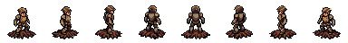

Made from approved/PL-01-3.png: 8 directions of the approved picture

### PL-01-3+stone-armour-cracks-all-over-and-falls-o · Hero base body (2026-11-21)

Made from approved/PL-01-3.png: stone armour cracks all over and falls off the body in chunks and dust

### FX-07-1+boulder-bursts-up-out-of-cracked-ground- · Ability effects for the animation rework (rock, stone, water, air, fire) (2026-11-21)

Made from approved/FX-07-1.png: boulder bursts up out of cracked ground and rises to float

### FX-07-1+boulder-bobs-gently-up-and-down-in-the-a · Ability effects for the animation rework (rock, stone, water, air, fire) (2026-11-21)

Made from approved/FX-07-1.png: boulder bobs gently up and down in the air, pebbles falling

### FX-07-1+boulder-tumbles-end-over-end-through-the · Ability effects for the animation rework (rock, stone, water, air, fire) (2026-11-21)

Made from approved/FX-07-1.png: boulder tumbles end over end through the air with a short dust trail

### FX-07-1+boulder-smashes-into-the-ground-rock-fra · Ability effects for the animation rework (rock, stone, water, air, fire) (2026-11-21)

Made from approved/FX-07-1.png: boulder smashes into the ground, rock fragments fly outward and a ring of dust spreads and fades

### FX-10-2 · Rock remade at hero scale (about 14 px), its flight; fire kick arc remade as an open crescent (2026-11-21) ✓ approved

a single rough brown-grey rock about 14 px wide near the left edge of the canvas, alone in empty space: no pebbles, no shadow, no ground, nothing else. Game spell/attack effect sprite, isometric view, 64x32 canvas. pixel art, isometric 2:1 view, no dark outline, limited palette, soft light from top-

### FX-10-3 · Rock remade at hero scale (about 14 px), its flight; fire kick arc remade as an open crescent (2026-11-21)

an open crescent of orange and yellow flame shaped like a half moon open on the right side, thick in the middle and tapering to sharp points at both ends, a few trailing embers, not a full circle. Game spell/attack effect sprite, isometric view, 64x64 canvas. pixel art, isometric 2:1 view, no dark o

### FX-10-4 · Rock remade at hero scale (about 14 px), its flight; fire kick arc remade as an open crescent (2026-11-21) ✓ approved

a sweeping C-shaped slash of fire, an open arc and not a full ring, bright yellow leading edge fading to red at the tail, small embers trailing behind. Game spell/attack effect sprite, isometric view, 64x64 canvas. pixel art, isometric 2:1 view, no dark outline, limited palette, soft light from top-

### PL-01-3+stone-armour-cracks-all-over-and-falls-o@east · Hero base body (2026-11-21)

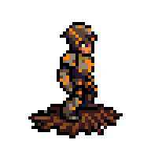

Made from approved/PL-01-3.png: stone armour cracks all over and falls off the body in chunks and dust

### PL-01-3+stone-armour-cracks-all-over-and-falls-o@north-east · Hero base body (2026-11-21)

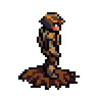

Made from approved/PL-01-3.png: stone armour cracks all over and falls off the body in chunks and dust

### PL-01-3+stone-armour-cracks-all-over-and-falls-o@north · Hero base body (2026-11-21)

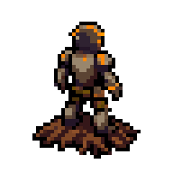

Made from approved/PL-01-3.png: stone armour cracks all over and falls off the body in chunks and dust

### PL-01-3+stone-armour-cracks-all-over-and-falls-o@north-west · Hero base body (2026-11-21)

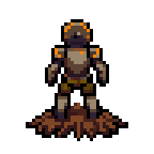

Made from approved/PL-01-3.png: stone armour cracks all over and falls off the body in chunks and dust

### PL-01-3+stone-armour-cracks-all-over-and-falls-o@west · Hero base body (2026-11-21)

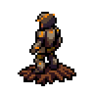

Made from approved/PL-01-3.png: stone armour cracks all over and falls off the body in chunks and dust

### PL-01-3+stone-armour-cracks-all-over-and-falls-o@south-west · Hero base body (2026-11-21)

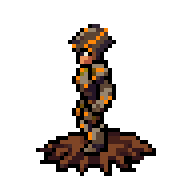

Made from approved/PL-01-3.png: stone armour cracks all over and falls off the body in chunks and dust

### PL-01-3+stone-armour-cracks-all-over-and-falls-o@south · Hero base body (2026-11-21)

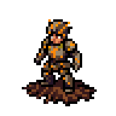

Made from approved/PL-01-3.png: stone armour cracks all over and falls off the body in chunks and dust

### FX-08-5+the-spiralling-wind-sweeps-outward-to-th · Air effects, spiral and transparent (options for Air Palm and Gust) (2026-11-21)

Made from approved/FX-08-5.png: the spiralling wind sweeps outward to the right, widening and swirling, then fades away

### FX-08-5+the-spiral-of-wind-spins-and-shoots-to-t · Air effects, spiral and transparent (options for Air Palm and Gust) (2026-11-21)

Made from approved/FX-08-5.png: the spiral of wind spins and shoots to the right, then thins out and fades away

### FX-10-1 · Rock remade at hero scale (about 14 px), its flight; fire kick arc remade as an open crescent (2026-11-21) ✓ approved

a single rough brown-grey rock about 14 px wide, centred, on its own: no pebbles, no shadow, no ground under it. Game spell/attack effect sprite, isometric view, 32x32 canvas. pixel art, isometric 2:1 view, no dark outline, limited palette, soft light from top-left, transparent background, high-fant

### FX-10-5 · Rock remade at hero scale (about 14 px), its flight; fire kick arc remade as an open crescent (2026-11-21)

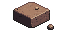

one smooth, solid, rounded brown-grey rock about 14 px wide, a single piece with no loose stones around it, no dark rim, no shadow, no ground, floating alone near the left edge of the canvas, empty space to the right. Game spell/attack effect sprite, isometric view, 64x32 canvas. pixel art, isometri

### FX-09-1+a-tiny-curl-of-water-grows-into-a-large- · Water whip effect, remade from the user's reference strip (2026-11-21)

Made from approved/FX-09-1.png: a tiny curl of water grows into a large S-shaped lash, snaps, then breaks apart into flying droplets and bursts into a star-shaped splash that fades

### FX-10-1+the-rock-smashes-into-the-ground-and-bre · Rock remade at hero scale (about 14 px), its flight; fire kick arc remade as an open crescent (2026-11-21)

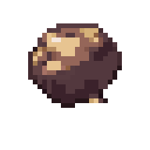

Made from approved/FX-10-1.png: the rock smashes into the ground and breaks into fragments, a small puff of dust spreads and fades

### FX-10-2+the-rock-flies-forward-to-the-right-acro · Rock remade at hero scale (about 14 px), its flight; fire kick arc remade as an open crescent (2026-11-21)

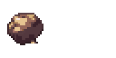

Made from approved/FX-10-2.png: the rock flies forward to the right across the canvas in a low arc, tumbling end over end; it travels alone, no pebbles or dust follow it

### FX-10-4+the-flame-arc-sweeps-around-fast-in-a-ha · Rock remade at hero scale (about 14 px), its flight; fire kick arc remade as an open crescent (2026-11-21)

Made from approved/FX-10-4.png: the flame arc sweeps around fast in a half circle, then fades into embers

### NP-02-1+8dir · Caedan Ashvale (2026-11-20)

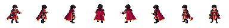

Made from approved/NP-02-1.png: 8 directions of the approved picture

### NP-02-1+fire-cast@north-east · Caedan Ashvale (2026-11-20)

Made from approved/NP-02-1.png: fire cast

### NP-02-1+fire-cast@north · Caedan Ashvale (2026-11-20)

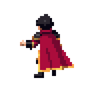

Made from approved/NP-02-1.png: fire cast

### NP-02-1+fire-cast@north-west · Caedan Ashvale (2026-11-20)

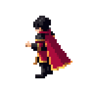

Made from approved/NP-02-1.png: fire cast

### NP-02-1+fire-cast@west · Caedan Ashvale (2026-11-20)

Made from approved/NP-02-1.png: fire cast

### NP-02-1+fire-cast@south-west · Caedan Ashvale (2026-11-20)

Made from approved/NP-02-1.png: fire cast

### NP-02-1+fire-cast@south · Caedan Ashvale (2026-11-20)

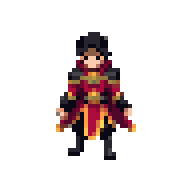

Made from approved/NP-02-1.png: fire cast

### NP-02-1+fire-cast@east · Caedan Ashvale (2026-11-20)

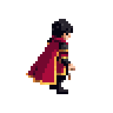

Made from approved/NP-02-1.png: fire cast

### NP-02-5 · Caedan Ashvale (2026-11-18)

 

Made from approved/NP-02-1.png: the same prince in a relaxed idle stance: both arms lowered and resting at his sides, hands empty, same outfit, colours, size and position (about 32 px tall, feet at (24, 40)), crisp pixels, dark outline like the game's hero, facing south-east

### BO-06-1 · Caedan with Stillheart (2026-11-18)

 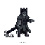

Made from approved/NP-02-1.png: turned dark king: grey ashen skin, cracked black crystal crown, tattered grey royal coat, carrying a jagged black crystal sword leaking grey smoke; about 34 px tall, feet at bottom centre (32, 52) of the 64x64 canvas so the blade and smoke aura fit

### NP-02-1+talking · Caedan Ashvale (2026-11-18)

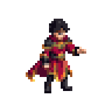

Made from approved/NP-02-1.png: talking

### NP-02-1+fire-cast · Caedan Ashvale (2026-11-18)

Made from approved/NP-02-1.png: fire cast

### PL-01-1+idle@south ·  (2026-11-17)

### PL-01-1+walk@south ·  (2026-11-17)

### PL-01-1+cast@south ·  (2026-11-17)

### PL-01-1+getting-hit@south ·  (2026-11-17)

### PL-01-1+death@south ·  (2026-11-17)

### PL-01-1+downed@south ·  (2026-11-17)

### PL-01-1+revived@south ·  (2026-11-17)

### PL-01-1+idle@north ·  (2026-11-17)

### PL-01-1+walk@north ·  (2026-11-17)

### PL-01-1+cast@north ·  (2026-11-17)

### PL-01-1+getting-hit@north ·  (2026-11-17)

### PL-01-1+death@north ·  (2026-11-17)

### PL-01-1+downed@north ·  (2026-11-17)

### PL-01-1+revived@north ·  (2026-11-17)

### PL-01-1+idle@east ·  (2026-11-17)

### PL-01-1+walk@east ·  (2026-11-17)

### PL-01-1+cast@east ·  (2026-11-17)

### PL-01-1+getting-hit@east ·  (2026-11-17)

### PL-01-1+death@east ·  (2026-11-17)

### PL-01-1+downed@east ·  (2026-11-17)

### PL-01-1+revived@east ·  (2026-11-17)

### PL-01-1+idle@west ·  (2026-11-17)

### PL-01-1+walk@west ·  (2026-11-17)

### PL-01-1+cast@west ·  (2026-11-17)

### PL-01-1+getting-hit@west ·  (2026-11-17)

### PL-01-1+death@west ·  (2026-11-17)

### PL-01-1+downed@west ·  (2026-11-17)

### PL-01-1+revived@west ·  (2026-11-17)

### PL-02-1+sword-slash@south ·  (2026-11-17)

### PL-02-1+sword-slash@north ·  (2026-11-17)

### PL-02-1+sword-slash@east ·  (2026-11-17)

### PL-02-1+sword-slash@west ·  (2026-11-17)

### PL-02-1+sword-lunge@south ·  (2026-11-17)

### PL-02-1+sword-lunge@north ·  (2026-11-17)

### PL-02-1+sword-lunge@east ·  (2026-11-17)

### PL-02-1+sword-lunge@west ·  (2026-11-17)

### PL-02-2+quick-bow-shot@south ·  (2026-11-17)

### PL-02-2+quick-bow-shot@north ·  (2026-11-17)

### PL-02-2+quick-bow-shot@east ·  (2026-11-17)

### PL-02-2+quick-bow-shot@west ·  (2026-11-17)

### PL-02-2+aimed-bow-shot@south ·  (2026-11-17)

### PL-02-2+aimed-bow-shot@north ·  (2026-11-17)

### PL-02-2+aimed-bow-shot@east ·  (2026-11-17)

### PL-02-2+aimed-bow-shot@west ·  (2026-11-17)

### NP-02-1 · Caedan Ashvale (2026-11-17) ✓ approved

a regal, charismatic young prince standing tall and proud, crimson and black royal coat richly embroidered with gold, black obsidian shoulder plates, gold sash, short dark hair, confident commanding smile, small flame floating above one palm, from the Ashkara region of the world of Veyra. Single cha

### NP-02-2 · Caedan Ashvale (2026-11-17)

a powerful, commanding young prince in black and crimson lamellar half-armor over a royal coat, thin gold circlet, long flowing red cape, one hand resting on a sword hilt, short dark hair, intense charismatic gaze, from the Ashkara region of the world of Veyra. Single character sprite, facing south-

### NP-02-3 · Caedan Ashvale (2026-11-17)

a powerful young fire-mage prince in long crimson robes with ember-orange trim and gold embroidery, black obsidian pauldrons, gold sash and crown-like circlet, short dark hair, regal stance, flames swirling around one raised hand, from the Ashkara region of the world of Veyra. Single character sprit

### NP-07-2 · Warden Kesh and Surveyor Iven (2026-11-17)

 

Made from approved/NP-07-1.png: the same character redrawn at the game's hero scale: much smaller, about 32 px tall and 17 px wide, feet at bottom centre (24, 40) of the 48x48 canvas, same outfit and colours, chunky readable pixels with a dark outline like the hero, no ground shadow, facing south-east

### NP-08-2 · Sela and Keeper Amaru (2026-11-17)

 

Made from approved/NP-08-1.png: the same character redrawn at the game's hero scale: much smaller, about 32 px tall and 17 px wide, feet at bottom centre (24, 40) of the 48x48 canvas, same outfit and colours, chunky readable pixels with a dark outline like the hero, no ground shadow, facing south-east

### NP-07-3 · Warden Kesh and Surveyor Iven (2026-11-17)

 

Made from approved/NP-07-1.png: clean up this small pixel-art character: same character, same pose, same size and position (about 32 px tall, feet at (24, 40)), crisp hand-placed pixels, clear readable face and outfit, dark outline like the game's hero, no ground shadow, facing south-east

### NP-08-3 · Sela and Keeper Amaru (2026-11-17)

 

Made from approved/NP-08-1.png: clean up this small pixel-art character: same character, same pose, same size and position (about 32 px tall, feet at (24, 40)), crisp hand-placed pixels, clear readable face and outfit, dark outline like the game's hero, no ground shadow, facing south-east

### NP-02-4 · Caedan Ashvale (2026-11-17)

 

Made from approved/NP-02-3.png: clean up this small pixel-art prince: same character, same outfit and colours, same size and position (about 32 px tall, feet at (24, 40)), remove the fire from his raised hand so the hand is empty with no flames or glow anywhere, crisp hand-placed pixels, clear readable face, dark outline like the 

### NP-07-1+8dir · Warden Kesh and Surveyor Iven (2026-11-17)

Made from approved/NP-07-1.png: 8 directions of the approved picture

### NP-07-1+idle · Warden Kesh and Surveyor Iven (2026-11-17)

Made from approved/NP-07-1.png: idle

### NP-07-1+talking · Warden Kesh and Surveyor Iven (2026-11-17)

Made from approved/NP-07-1.png: talking

### NP-08-1+8dir · Sela and Keeper Amaru (2026-11-17)

Made from approved/NP-08-1.png: 8 directions of the approved picture

### NP-08-1+idle · Sela and Keeper Amaru (2026-11-17)

Made from approved/NP-08-1.png: idle

### NP-08-1+talking · Sela and Keeper Amaru (2026-11-17)

Made from approved/NP-08-1.png: talking

### NP-08-1+heal-cast · Sela and Keeper Amaru (2026-11-17)

Made from approved/NP-08-1.png: heal cast

### PL-02-1+8dir ·  (2026-11-16)

### PL-02-2+8dir ·  (2026-11-16)

### PL-01-1+idle@south-west ·  (2026-11-16)

### PL-01-1+walk@south-west ·  (2026-11-16)

### PL-01-1+cast@south-west ·  (2026-11-16)

### PL-01-1+getting-hit@south-west ·  (2026-11-16)

### PL-01-1+death@south-west ·  (2026-11-16)

### PL-01-1+downed@south-west ·  (2026-11-16)

### PL-01-1+revived@south-west ·  (2026-11-16)

### PL-01-1+idle@north-west ·  (2026-11-16)

### PL-01-1+walk@north-west ·  (2026-11-16)

### PL-01-1+cast@north-west ·  (2026-11-16)

### PL-01-1+getting-hit@north-west ·  (2026-11-16)

### PL-01-1+death@north-west ·  (2026-11-16)

### PL-01-1+downed@north-west ·  (2026-11-16)

### PL-01-1+revived@north-west ·  (2026-11-16)

### PL-01-1+idle@north-east ·  (2026-11-16)

### PL-01-1+walk@north-east ·  (2026-11-16)

### PL-01-1+cast@north-east ·  (2026-11-16)

### PL-01-1+getting-hit@north-east ·  (2026-11-16)

### PL-01-1+death@north-east ·  (2026-11-16)

### PL-01-1+downed@north-east ·  (2026-11-16)

### PL-01-1+revived@north-east ·  (2026-11-16)

### PL-02-1+sword-slash ·  (2026-11-16)

### PL-02-1+sword-slash@south-west ·  (2026-11-16)

### PL-02-1+sword-slash@north-west ·  (2026-11-16)

### PL-02-1+sword-slash@north-east ·  (2026-11-16)

### PL-02-1+sword-lunge ·  (2026-11-16)

### PL-02-1+sword-lunge@south-west ·  (2026-11-16)

### PL-02-1+sword-lunge@north-west ·  (2026-11-16)

### PL-02-1+sword-lunge@north-east ·  (2026-11-16)

### PL-02-2+quick-bow-shot ·  (2026-11-16)

### PL-02-2+quick-bow-shot@south-west ·  (2026-11-16)

### PL-02-2+quick-bow-shot@north-west ·  (2026-11-16)

### PL-02-2+quick-bow-shot@north-east ·  (2026-11-16)

### PL-02-2+aimed-bow-shot ·  (2026-11-16)

### PL-02-2+aimed-bow-shot@south-west ·  (2026-11-16)

### PL-02-2+aimed-bow-shot@north-west ·  (2026-11-16)

### PL-02-2+aimed-bow-shot@north-east ·  (2026-11-16)

### BO-02-1 · Ashbark Colossus (2026-11-15)

an ancient giant made of ash-grey bark and smouldering branches, glowing ember core. Single sprite, facing south-east (front three-quarter isometric view), full body, about 90 px tall on a 128x128 canvas, idle pose. pixel art, isometric 2:1 view, no dark outline (edges come from shading and a darker

### BO-03-1 · Riverwyrm (2026-11-15)

a colossal green-and-gold anaconda-like river serpent, crowned with fins, from the Tidereach region of the world of Veyra. Single character sprite, facing south-east (front three-quarter isometric view), full body, large creature on a 96x96 canvas, idle standing pose. pixel art, isometric 2:1 view, 

### BO-04-1 · First Ashvale (spirit) (2026-11-15)

a ghostly ancient king, translucent blue-white, obsidian crown, burning Sunstone sceptre. Single sprite, facing south-east (front three-quarter isometric view), full body, about 90 px tall on a 128x128 canvas, idle pose. pixel art, isometric 2:1 view, no dark outline (edges come from shading and a d

### BO-06-2 · Caedan with Stillheart (2026-11-15)

a jagged black crystal sword with grey smoke aura and drained colored sparks. Game spell/attack effect sprite, isometric view, glowing, bright readable colors, 64x64 canvas. pixel art, isometric 2:1 view, no dark outline (edges come from shading and a darker tone of each part's own colour, not black

### EN-03-1 · Salamander hounds (2026-11-15)

a lean red salamander-like hound with glowing orange spots and a smoking tail, from the Ashkara region of the world of Veyra. Single character sprite, facing south-east (front three-quarter isometric view), full body, small to medium creature on a 48x48 canvas, idle standing pose. pixel art, isometr

### EN-04-1 · Cinder vultures (2026-11-15)

a black vulture with ash-grey wingtips and glowing ember eyes, from the Ashkara region of the world of Veyra. Single character sprite, facing south-east (front three-quarter isometric view), full body, small to medium creature on a 48x48 canvas, idle standing pose. pixel art, isometric 2:1 view, no 

### EN-05-1 · Moon jaguars (2026-11-15)

a black jaguar with silver moon-shaped rosettes and glowing blue eyes, from the Tidereach region of the world of Veyra. Single character sprite, facing south-east (front three-quarter isometric view), full body, small to medium creature on a 48x48 canvas, idle standing pose. pixel art, isometric 2:1

### EN-06-1 · Crown harpies (2026-11-15)

a giant harpy eagle with a grey crest crown and powerful talons, from the Tidereach region of the world of Veyra. Single character sprite, facing south-east (front three-quarter isometric view), full body, small to medium creature on a 48x48 canvas, idle standing pose. pixel art, isometric 2:1 view,

### EN-07-1 · Stone sentinels (2026-11-15)

a hulking stone golem guardian carved with clan runes, glowing amber eyes, from the Bedrun region of the world of Veyra. Single character sprite, facing south-east (front three-quarter isometric view), full body, small to medium creature on a 48x48 canvas, idle standing pose. pixel art, isometric 2:

### EN-08-1 · Summons: windmane, sky eagle, ghost leopard, Sunstone construct (2026-11-15)

a stocky steppe horse with a long mane that streams like wind and crackles with blue sparks, from the Vael region of the world of Veyra. Single character sprite, facing south-east (front three-quarter isometric view), full body, small to medium creature on a 48x48 canvas, idle standing pose. pixel a

### EN-08-2 · Summons: windmane, sky eagle, ghost leopard, Sunstone construct (2026-11-15)

a huge golden eagle with wings spread wide, from the Vael region of the world of Veyra. Single character sprite, facing south-east (front three-quarter isometric view), full body, small to medium creature on a 48x48 canvas, idle standing pose. pixel art, isometric 2:1 view, no dark outline (edges co

### NP-07-1 · Warden Kesh and Surveyor Iven (2026-11-15) ✓ approved

two Ashkarans: a scarred burn-master in soot-black leathers with a torch-staff, and a surveyor in red robes with a map tube. Single sprite, facing south-east (front three-quarter isometric view), full body, about 32 px tall and 16 px wide, feet at bottom centre (24, 40) of a 48x48 canvas, idle pose.

### NP-08-1 · Sela and Keeper Amaru (2026-11-15) ✓ approved

a calm middle-aged healer woman, teal and white flowing wraps, braided hair with river beads, small glowing water orb in hand, from the Tidereach region of the world of Veyra. Single character sprite, facing south-east (front three-quarter isometric view), full body, about 32 px tall and 16 px wide,

### NP-09-1 · Thane Orvek (2026-11-15)

a broad elderly earth-clan chieftain, thick white braided beard, stone-plate armor, barefoot, huge forearms, from the Bedrun region of the world of Veyra. Single character sprite, facing south-east (front three-quarter isometric view), full body, about 32 px tall and 16 px wide, feet at bottom centr

### NP-10-1 · Brother Wend (2026-11-15)

a thin elderly monk, shaved head, saffron robes over a grey felt coat, prayer beads, serene closed eyes, from the Vael region of the world of Veyra. Single character sprite, facing south-east (front three-quarter isometric view), full body, about 32 px tall and 16 px wide, feet at bottom centre (24,

### NP-11-1 · Captain Tavi Rhal (2026-11-15)

a disciplined Ember Hand officer woman, black and crimson lamellar armor, glaive, red plume. Single sprite, facing south-east (front three-quarter isometric view), full body, about 32 px tall and 16 px wide, feet at bottom centre (24, 40) of a 48x48 canvas, idle pose. pixel art, isometric 2:1 view, 

### WO-05-1 · Emberhold + Ash Forests + Heartwood Pyre (2026-11-15)

an obsidian palace with red banners, sharp black towers and gold braziers, from the Ashkara region of the world of Veyra. Isometric game tiles/props for a 32x16 isometric grid (blocks 32 px wide with 16 px side faces), seamless edges, several variants. pixel art, isometric 2:1 view, limited palette,

### WO-05-2 · Emberhold + Ash Forests + Heartwood Pyre (2026-11-15)

three versions of a tall ash tree: healthy with orange leaves, burning, and charred black, from the Ashkara region of the world of Veyra. Isometric game tiles/props for a 32x16 isometric grid (blocks 32 px wide with 16 px side faces), seamless edges, several variants. pixel art, isometric 2:1 view, 

### WO-06-1 · Lunhaven + Lowlands + Drowned Dig (2026-11-15)

flooded jungle floor tiles with roots, mud and shallow dark water, from the Tidereach region of the world of Veyra. Isometric game tiles/props for a 32x16 isometric grid (blocks 32 px wide with 16 px side faces), seamless edges, several variants. pixel art, isometric 2:1 view, limited palette, soft 

### WO-06-2 · Lunhaven + Lowlands + Drowned Dig (2026-11-15)

a giant kapok tree with buttress roots and a rope canopy walkway, from the Tidereach region of the world of Veyra. Isometric game tiles/props for a 32x16 isometric grid (blocks 32 px wide with 16 px side faces), seamless edges, several variants. pixel art, isometric 2:1 view, limited palette, soft l

### WO-07-1 · Underdeep (Bedru's Heart) (2026-11-15)

cave tiles with glowing teal lichen and tall purple crystal clusters, from the Bedrun region of the world of Veyra. Isometric game tiles/props for a 32x16 isometric grid (blocks 32 px wide with 16 px side faces), seamless edges, several variants. pixel art, isometric 2:1 view, limited palette, soft 

### WO-08-1 · Ice Spine monasteries + Stillpoint (2026-11-15)

frozen mountain rock blocks with ice and snow caps, from the Vael region of the world of Veyra. Isometric game tiles/props for a 32x16 isometric grid (blocks 32 px wide with 16 px side faces), seamless edges, several variants. pixel art, isometric 2:1 view, limited palette, soft light from top-left,

### WO-08-2 · Ice Spine monasteries + Stillpoint (2026-11-15)

a cliffside monastery with red-gold roofs and a hall of hanging bronze wind chimes, from the Vael region of the world of Veyra. Isometric game tiles/props for a 32x16 isometric grid (blocks 32 px wide with 16 px side faces), seamless edges, several variants. pixel art, isometric 2:1 view, limited pa

### WO-09-1 · High Calderas + Caldera Nest (2026-11-15)

black volcanic obsidian ground tiles and glassy cliff blocks with orange glow cracks, from the Ashkara region of the world of Veyra. Isometric game tiles/props for a 32x16 isometric grid (blocks 32 px wide with 16 px side faces), seamless edges, several variants. pixel art, isometric 2:1 view, limit

### WO-09-2 · High Calderas + Caldera Nest (2026-11-15)

molten lava tiles and lava river with cooled dark crust edges, from the Ashkara region of the world of Veyra. Isometric game tiles/props for a 32x16 isometric grid (blocks 32 px wide with 16 px side faces), seamless edges, several variants. pixel art, isometric 2:1 view, limited palette, soft light 

### PL-01-1+idle · Hero base body (2026-11-15)

Made from approved/PL-01-1.png: idle

### PL-01-1+walk · Hero base body (2026-11-15)

Made from approved/PL-01-1.png: walk

### PL-01-1+cast · Hero base body (2026-11-15)

Made from approved/PL-01-1.png: cast

### PL-01-1+getting-hit · Hero base body (2026-11-15)

Made from approved/PL-01-1.png: getting hit

### PL-01-1+death · Hero base body (2026-11-15)

   

Made from approved/PL-01-1.png: death

### PL-01-1+downed · Hero base body (2026-11-15)

Made from approved/PL-01-1.png: downed

### PL-01-1+revived · Hero base body (2026-11-15)

Made from approved/PL-01-1.png: revived

### BO-01-1 · The Foreman + Grey Heart (2026-11-14)

a hulking corrupted miner boss, grey cracked skin, glowing Sunstone shards in his back, giant pick-hammer, from the Bedrun region of the world of Veyra. Single character sprite, facing south-east (front three-quarter isometric view), full body, large creature on a 96x96 canvas, idle standing pose. p

### BO-01-2 · The Foreman + Grey Heart (2026-11-14)

a large floating crystal of black-gold Sunstone, cracked, pulsing with grey smoke, from the Bedrun region of the world of Veyra. Single character sprite, facing south-east (front three-quarter isometric view), full body, large creature on a 96x96 canvas, idle standing pose. pixel art, isometric 2:1 

### EN-02-1 · Human husks (+ Ember Hand soldier reskin) (2026-11-14)

Ashkaran soldier in black and crimson lamellar armor with a glaive, and a Crucible student in red robes, from the Ashkara region of the world of Veyra. Single character sprite, facing south-east (front three-quarter isometric view), full body, about 32 px tall and 16 px wide, feet at bottom centre (

### FX-04-1 · Air effects (2026-11-14)

a palm-shaped gust of white wind lines. Game spell/attack effect sprite, isometric view, glowing, bright readable colors, 64x64 canvas. pixel art, isometric 2:1 view, limited palette, soft light from top-left, transparent background, high-fantasy RPG style.

### FX-04-2 · Air effects (2026-11-14)

a small swirling tornado with debris. Game spell/attack effect sprite, isometric view, glowing, bright readable colors, 64x64 canvas. pixel art, isometric 2:1 view, limited palette, soft light from top-left, transparent background, high-fantasy RPG style.

### IC-03-1 · Armor, consumables, materials, quest items, rarity frames (2026-11-14)

armor icons: helmet, chestplate, leggings, boots, gloves, ring, amulet. Inventory icons, each 32x32, front view centered, bold silhouette, slight drop shadow. Pixel art, limited palette, transparent background, high-fantasy RPG style.

### IC-03-2 · Armor, consumables, materials, quest items, rarity frames (2026-11-14)

a red health potion and a blue mana potion in glass flasks. Inventory icons, each 32x32, front view centered, bold silhouette, slight drop shadow. Pixel art, limited palette, transparent background, high-fantasy RPG style.

### NP-05-1 · Generic townsfolk (recolor per region) (2026-11-14)

a set of townsfolk: merchant with apron, town guard with spear, quest-giver elder with cane, from the Crossing region of the world of Veyra. Single character sprite, facing south-east (front three-quarter isometric view), full body, about 32 px tall and 16 px wide, feet at bottom centre (24, 40) of 

### NP-05-2 · Generic townsfolk (recolor per region) (2026-11-14)

three guild members: a swordmaster in a blue dueling coat, a hooded ranger in green with a bow, a burly smith with a hammer and leather apron, from the Crossing region of the world of Veyra. Single character sprite, facing south-east (front three-quarter isometric view), full body, about 32 px tall 

### NP-06-1 · Sovereign Ilsar (2026-11-14)

a stern older king, greying beard, heavy crimson and black robes, obsidian crown, imposing posture, from the Ashkara region of the world of Veyra. Single character sprite, facing south-east (front three-quarter isometric view), full body, about 32 px tall and 16 px wide, feet at bottom centre (24, 4

### UI-03-1 · Dialogue box + portraits (12 quest givers) (2026-11-14)

a dialogue text box with a name plate and portrait slot, wood and parchment. Game UI element, pixel art, crisp edges, readable at 1x, limited palette, high-fantasy RPG style, transparent background.

### UI-03-2 · Dialogue box + portraits (12 quest givers) (2026-11-14)

Close-up bust portraits, 64x64 each, of: a young prince in a red-black coat (Caedan) in three moods (warm, troubled, cold and grey); a calm teal-robed healer woman; an old bearded earth chieftain; an elderly saffron-robed monk; a stern crowned king. Pixel art, limited palette, soft light, high-fanta

### UI-04-1 · Title, logo, fonts, nation emblems (2026-11-14)

game logo text 'VEYRA' with four element symbols (flame, stone, wave, wind). Game UI element, pixel art, crisp edges, readable at 1x, limited palette, high-fantasy RPG style, transparent background.

### UI-04-2 · Title, logo, fonts, nation emblems (2026-11-14)

readable pixel font, uppercase and lowercase alphabet. Game UI element, pixel art, crisp edges, readable at 1x, limited palette, high-fantasy RPG style, transparent background.

### WO-02-1 · Millbrook + the Crossing (guild hall, quest boards, respawn shrine) (2026-11-14)

medieval market-town buildings: timber inn, market stalls with awnings, stone city wall and gate, from the Crossing region of the world of Veyra. Isometric game tiles/props for a 32x16 isometric grid (blocks 32 px wide with 16 px side faces), seamless edges, several variants. pixel art, isometric 2:

### WO-02-2 · Millbrook + the Crossing (guild hall, quest boards, respawn shrine) (2026-11-14)

three guild buildings: a fencing hall with crossed-swords banner, a ranger lodge of logs, a stone forge with chimney, from the Crossing region of the world of Veyra. Isometric game tiles/props for a 32x16 isometric grid (blocks 32 px wide with 16 px side faces), seamless edges, several variants. pix

### WO-03-1 · Deepcut + Silent Shaft + Clan Halls (2026-11-14)

red sandstone canyon cliff blocks and green terraced farm steps, from the Bedrun region of the world of Veyra. Isometric game tiles/props for a 32x16 isometric grid (blocks 32 px wide with 16 px side faces), seamless edges, several variants. pixel art, isometric 2:1 view, limited palette, soft light

### WO-03-2 · Deepcut + Silent Shaft + Clan Halls (2026-11-14)

a timber mine entrance with rail track and cart, rock wall with glowing gold Sunstone seams, from the Bedrun region of the world of Veyra. Isometric game tiles/props for a 32x16 isometric grid (blocks 32 px wide with 16 px side faces), seamless edges, several variants. pixel art, isometric 2:1 view,

### WO-04-1 · Windsteppe camps (gers, cairns, snow) (2026-11-14)

cold steppe grass tiles and snow-covered grass tiles, from the Vael region of the world of Veyra. Isometric game tiles/props for a 32x16 isometric grid (blocks 32 px wide with 16 px side faces), seamless edges, several variants. pixel art, isometric 2:1 view, limited palette, soft light from top-lef

### WO-04-2 · Windsteppe camps (gers, cairns, snow) (2026-11-14)

a round white felt nomad tent with a wooden door and smoke hole, from the Vael region of the world of Veyra. Isometric game tiles/props for a 32x16 isometric grid (blocks 32 px wide with 16 px side faces), seamless edges, several variants. pixel art, isometric 2:1 view, limited palette, soft light f

### NP-03-1 · Steward Brann (2026-11-09)

a portly mine steward, dusty waistcoat, ledger, lamp at belt, smug expression. Single sprite, facing south-east (front three-quarter isometric view), full body, about 32 px tall and 16 px wide, feet at bottom centre (24, 40) of a 48x48 canvas, idle pose. pixel art, isometric 2:1 view, no dark outlin

### NP-04-1 · Saran (2026-11-09)

a weathered steppe clan matriarch, fur-lined felt coat, silver headdress, walking staff. Single sprite, facing south-east (front three-quarter isometric view), full body, about 32 px tall and 16 px wide, feet at bottom centre (24, 40) of a 48x48 canvas, idle pose. pixel art, isometric 2:1 view, no d

### UI-02-1 · Menus: character, ability tree, inventory, quest log (2026-11-08)

a parchment-and-wood character panel with equipment slots around a silhouette. Game UI element, pixel art, crisp edges, readable at 1x, limited palette, high-fantasy RPG style, transparent background.

### UI-02-2 · Menus: character, ability tree, inventory, quest log (2026-11-08)

an ability tree panel with tiered icon slots and connecting lines on dark parchment. Game UI element, pixel art, crisp edges, readable at 1x, limited palette, high-fantasy RPG style, transparent background.

### PL-03-1 · Armor layers (4 nation styles) (2026-11-08)

 

Made from approved/PL-01-1.png: wearing an armor set of crimson Crucible robes with ember-orange trim, black obsidian shoulder plates and a gold sash (Ashkara)

### PL-03-2 · Armor layers (4 nation styles) (2026-11-08)

 

Made from approved/PL-01-1.png: wearing an armor set of heavy stone-grey plate with leather straps, a miner's helmet with a lamp and ochre cloth (Bedrun)

### NP-01-1 · Maren Voss (2026-11-08)

a sharp-eyed Floor Guild recruiter woman, blue guild coat, clipboard, short auburn hair. Single sprite, facing south-east (front three-quarter isometric view), full body, about 32 px tall and 16 px wide, feet at bottom centre (24, 40) of a 48x48 canvas, idle pose. pixel art, isometric 2:1 view, no d

### FX-06-1 · General: hit sparks, status loops, telegraphs, level-up (2026-11-07)

set of small hit sparks: white physical spark, purple magic burst. Game spell/attack effect sprite, isometric view, glowing, bright readable colors, 64x64 canvas. pixel art, isometric 2:1 view, limited palette, soft light from top-left, transparent background, high-fantasy RPG style.

### FX-06-2 · General: hit sparks, status loops, telegraphs, level-up (2026-11-07)

small looping icons above a head: stun stars, root vines, slow snail swirl, silence bubble, sleep Zzz, burn flame, bleed drops, poison bubbles. Game spell/attack effect sprite, isometric view, glowing, bright readable colors, 64x64 canvas. pixel art, isometric 2:1 view, limited palette, soft light f

### IC-04-1 · Buff and debuff icons (2026-11-07)

set of small round buff and debuff icons. Inventory icons, each 32x32, front view centered, bold silhouette, slight drop shadow. Pixel art, limited palette, transparent background, high-fantasy RPG style.

### UI-01-1 · HUD: action bar, unit frames, numbers, minimap (2026-11-07)

a fantasy action bar with 10 square slots, stone-and-bronze frame. Game UI element, pixel art, crisp edges, readable at 1x, limited palette, high-fantasy RPG style, transparent background.

### UI-01-2 · HUD: action bar, unit frames, numbers, minimap (2026-11-07)

a portrait frame with red health bar and blue mana bar, bronze trim. Game UI element, pixel art, crisp edges, readable at 1x, limited palette, high-fantasy RPG style, transparent background.

### WO-01-1 · Base tileset + plants + props + lights (2026-11-06)

props set: wooden chest, barrel, crate, signpost, table and stool. Isometric game tiles/props for a 32x16 isometric grid (blocks 32 px wide with 16 px side faces), seamless edges, several variants. pixel art, isometric 2:1 view, limited palette, soft light from top-left, transparent background, high

### WO-01-2 · Base tileset + plants + props + lights (2026-11-06)

props set: wall torch, standing lamp, brazier, glowing gold Sunstone lamp. Isometric game tiles/props for a 32x16 isometric grid (blocks 32 px wide with 16 px side faces), seamless edges, several variants. pixel art, isometric 2:1 view, limited palette, soft light from top-left, transparent backgrou

### FX-01-2 · Fire effects (2026-11-06)

a whip of fire, a straight stream of flame and a cone of fire breath. Game spell/attack effect sprite, isometric view, glowing, bright readable colors, 64x64 canvas. pixel art, isometric 2:1 view, limited palette, soft light from top-left, transparent background, high-fantasy RPG style.

### PL-01-1 · Hero base body (2026-11-06) ✓ approved

 

a young adventurer in a plain linen tunic, trousers and boots, short hair, neutral build, no weapon, ready for gear to be layered on. Single character sprite, facing south-east (front three-quarter isometric view), full body, about 32 px tall and 16 px wide, feet at bottom centre (24, 40) of a 48x48

### PL-01-1+8dir · Hero base body (2026-11-06)

 

Made from approved/PL-01-1.png: 8 directions of the approved picture

### PL-01-2 · Hero base body (2026-11-06)

 

Made from approved/PL-01-1.png: empty-handed, in a martial-arts bending stance

### PL-02-1 · Weapon attacks: sword, bow, hammer (2026-11-06)

 

Made from approved/PL-01-1.png: holding a one-handed sword

### PL-02-2 · Weapon attacks: sword, bow, hammer (2026-11-06)

 

Made from approved/PL-01-1.png: holding a recurve bow and quiver

### FX-01-1 · Fire effects (2026-11-06)

9 small bursts of fire from a punch and a kick, each shooting sideways (horizontally), each no bigger than 16x16 pixels, arranged in a 3x3 grid with empty space between them, each one slightly different. Game spell/attack effect sprite, isometric view, glowing, bright readable colors, 64x64 canvas. 

### FX-02-1 · Earth effects (2026-11-06)

a spinning rock chunk with dust trail. Game spell/attack effect sprite, isometric view, glowing, bright readable colors, 64x64 canvas. pixel art, isometric 2:1 view, limited palette, soft light from top-left, transparent background, high-fantasy RPG style.

### FX-02-2 · Earth effects (2026-11-06)

ground cracks spreading with dust and pebbles. Game spell/attack effect sprite, isometric view, glowing, bright readable colors, 64x64 canvas. pixel art, isometric 2:1 view, limited palette, soft light from top-left, transparent background, high-fantasy RPG style.

### FX-03-1 · Water effects (2026-11-06)

a whip of clear water, a high-pressure water jet and a rolling wave. Game spell/attack effect sprite, isometric view, glowing, bright readable colors, 64x64 canvas. pixel art, isometric 2:1 view, limited palette, soft light from top-left, transparent background, high-fantasy RPG style.

### FX-03-2 · Water effects (2026-11-06)

rising green-blue healing sparkles and soft mist. Game spell/attack effect sprite, isometric view, glowing, bright readable colors, 64x64 canvas. pixel art, isometric 2:1 view, limited palette, soft light from top-left, transparent background, high-fantasy RPG style.

### FX-05-1 · Weapon effects: slash, parry, dash, arrows, traps, slam (2026-11-06)

a bright crescent sword slash arc. Game spell/attack effect sprite, isometric view, glowing, bright readable colors, 64x64 canvas. pixel art, isometric 2:1 view, limited palette, soft light from top-left, transparent background, high-fantasy RPG style.

### FX-05-2 · Weapon effects: slash, parry, dash, arrows, traps, slam (2026-11-06)

a sharp white spark flash from blades clashing. Game spell/attack effect sprite, isometric view, glowing, bright readable colors, 64x64 canvas. pixel art, isometric 2:1 view, limited palette, soft light from top-left, transparent background, high-fantasy RPG style.

