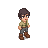

# Art drafts

Made by the art bot (`tools/art_bot/` on the main branch) from the art tracker's prompts.
5 of 73 stills done. Newest first. These are drafts: copy the
keepers into the game's `assets/` folder by hand.

**To build on a draft** (new weapon or outfit, 8 directions, animations), copy it to
`approved/<KEY>.png` on this branch, for example `approved/PL-01-1.png`.

## Waiting for an approved base

- `approved/PL-01-1.png` unlocks PL-01-2, PL-02-1, PL-02-2, PL-03-1, PL-03-2
- `approved/NP-02-1.png` unlocks BO-06-1

## Approve to animate

- `approved/PL-01-1.png` unlocks 8 directions, idle, walk, cast, getting hit, death, downed, revived

## Drafts

### PL-01-1 · Hero base body (2026-11-06)

a young adventurer in a plain linen tunic, trousers and boots, short hair, neutral build, no weapon, ready for gear to be layered on. Single character sprite, facing south-east (front three-quarter isometric view), full body, about 32 px tall and 16 px wide, feet at bottom centre (24, 40) of a 48x48

### WO-01-1 · Base tileset + plants + props + lights (2026-11-06)

props set: wooden chest, barrel, crate, signpost, table and stool. Isometric game tiles/props for a 32x16 isometric grid (blocks 32 px wide with 16 px side faces), seamless edges, several variants. pixel art, isometric 2:1 view, limited palette, soft light from top-left, transparent background, high

### WO-01-2 · Base tileset + plants + props + lights (2026-11-06)

props set: wall torch, standing lamp, brazier, glowing gold Sunstone lamp. Isometric game tiles/props for a 32x16 isometric grid (blocks 32 px wide with 16 px side faces), seamless edges, several variants. pixel art, isometric 2:1 view, limited palette, soft light from top-left, transparent backgrou

### FX-01-1 · Fire effects (2026-11-06)

burst of fire from a punch and a kick. Game spell/attack effect sprite, isometric view, glowing, bright readable colors, 64x64 canvas. pixel art, isometric 2:1 view, limited palette, soft light from top-left, transparent background, high-fantasy RPG style.

### FX-01-2 · Fire effects (2026-11-06)

a whip of fire, a straight stream of flame and a cone of fire breath. Game spell/attack effect sprite, isometric view, glowing, bright readable colors, 64x64 canvas. pixel art, isometric 2:1 view, limited palette, soft light from top-left, transparent background, high-fantasy RPG style.

