# Art drafts

Made by the art bot (`tools/art_bot/` on the main branch) from the art tracker's prompts.
81 of 81 stills done. Newest first. These are drafts: copy the
keepers into the game's `assets/` folder by hand.

**To build on a draft** (new weapon or outfit, 8 directions, animations), copy it to
`approved/<KEY>.png` on this branch, for example `approved/PL-01-1.png`.

## Approve to animate

- `approved/PL-02-1.png` unlocks 8 directions, sword slash, sword lunge
- `approved/PL-02-2.png` unlocks 8 directions, quick bow shot, aimed bow shot
- `approved/NP-01-1.png` unlocks 8 directions, idle, talking
- `approved/NP-02-5.png` unlocks 8 directions, idle, walk
- `approved/NP-03-1.png` unlocks 8 directions, idle, talking
- `approved/NP-04-1.png` unlocks 8 directions, idle, talking
- `approved/NP-05-1.png` unlocks 8 directions, idle, walk, talking
- `approved/NP-05-2.png` unlocks 8 directions, idle, walk, talking
- `approved/EN-02-1.png` unlocks 8 directions, idle, walk, attack, death
- `approved/BO-01-1.png` unlocks 8 directions, idle, attack, winding up a big attack, phase change, death
- `approved/BO-01-2.png` unlocks 8 directions, idle, attack, winding up a big attack, phase change, death
- `approved/NP-06-1.png` unlocks 8 directions, idle, talking
- `approved/EN-03-1.png` unlocks 8 directions, idle, run, bite, death
- `approved/EN-04-1.png` unlocks 8 directions, fly, dive, death
- `approved/BO-02-1.png` unlocks 8 directions, idle, slam, winding up a big attack, burn, death
- `approved/EN-05-1.png` unlocks 8 directions, idle, run, pounce, death
- `approved/EN-06-1.png` unlocks 8 directions, fly, dive, death
- `approved/BO-03-1.png` unlocks 8 directions, rise, bite, coil, submerge, death
- `approved/NP-09-1.png` unlocks 8 directions, idle, talking, earth cast, death
- `approved/EN-07-1.png` unlocks 8 directions, idle, walk, slam, death
- `approved/NP-10-1.png` unlocks 8 directions, idle, talking, meditate
- `approved/NP-11-1.png` unlocks 8 directions, idle, walk, attack, death
- `approved/EN-08-1.png` unlocks 8 directions, idle, move, attack
- `approved/EN-08-2.png` unlocks 8 directions, idle, move, attack
- `approved/BO-04-1.png` unlocks 8 directions, idle, cast, winding up a big attack, death
- `approved/BO-06-1.png` unlocks 8 directions, powering up between phases, capstone cast, death

## Drafts

### NP-02-1+8dir · Caedan Ashvale (2026-11-20)

Made from approved/NP-02-1.png: 8 directions of the approved picture

### NP-02-5 · Caedan Ashvale (2026-11-18)

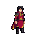 

Made from approved/NP-02-1.png: the same prince in a relaxed idle stance: both arms lowered and resting at his sides, hands empty, same outfit, colours, size and position (about 32 px tall, feet at (24, 40)), crisp pixels, dark outline like the game's hero, facing south-east

### BO-06-1 · Caedan with Stillheart (2026-11-18)

 

Made from approved/NP-02-1.png: turned dark king: grey ashen skin, cracked black crystal crown, tattered grey royal coat, carrying a jagged black crystal sword leaking grey smoke; about 34 px tall, feet at bottom centre (32, 52) of the 64x64 canvas so the blade and smoke aura fit

### NP-02-1+talking · Caedan Ashvale (2026-11-18)

Made from approved/NP-02-1.png: talking

### NP-02-1+fire-cast · Caedan Ashvale (2026-11-18)

Made from approved/NP-02-1.png: fire cast

### PL-01-1+idle@south ·  (2026-11-17)

### PL-01-1+walk@south ·  (2026-11-17)

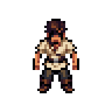

### PL-01-1+cast@south ·  (2026-11-17)

### PL-01-1+getting-hit@south ·  (2026-11-17)

### PL-01-1+death@south ·  (2026-11-17)

### PL-01-1+downed@south ·  (2026-11-17)

### PL-01-1+revived@south ·  (2026-11-17)

### PL-01-1+idle@north ·  (2026-11-17)

### PL-01-1+walk@north ·  (2026-11-17)

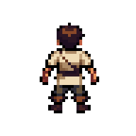

### PL-01-1+cast@north ·  (2026-11-17)

### PL-01-1+getting-hit@north ·  (2026-11-17)

### PL-01-1+death@north ·  (2026-11-17)

### PL-01-1+downed@north ·  (2026-11-17)

### PL-01-1+revived@north ·  (2026-11-17)

### PL-01-1+idle@east ·  (2026-11-17)

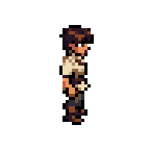

### PL-01-1+walk@east ·  (2026-11-17)

### PL-01-1+cast@east ·  (2026-11-17)

### PL-01-1+getting-hit@east ·  (2026-11-17)

### PL-01-1+death@east ·  (2026-11-17)

### PL-01-1+downed@east ·  (2026-11-17)

### PL-01-1+revived@east ·  (2026-11-17)

### PL-01-1+idle@west ·  (2026-11-17)

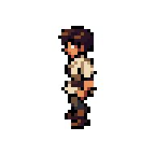

### PL-01-1+walk@west ·  (2026-11-17)

### PL-01-1+cast@west ·  (2026-11-17)

### PL-01-1+getting-hit@west ·  (2026-11-17)

### PL-01-1+death@west ·  (2026-11-17)

### PL-01-1+downed@west ·  (2026-11-17)

### PL-01-1+revived@west ·  (2026-11-17)

### PL-02-1+sword-slash@south ·  (2026-11-17)

### PL-02-1+sword-slash@north ·  (2026-11-17)

### PL-02-1+sword-slash@east ·  (2026-11-17)

### PL-02-1+sword-slash@west ·  (2026-11-17)

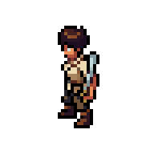

### PL-02-1+sword-lunge@south ·  (2026-11-17)

### PL-02-1+sword-lunge@north ·  (2026-11-17)

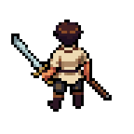

### PL-02-1+sword-lunge@east ·  (2026-11-17)

### PL-02-1+sword-lunge@west ·  (2026-11-17)

### PL-02-2+quick-bow-shot@south ·  (2026-11-17)

### PL-02-2+quick-bow-shot@north ·  (2026-11-17)

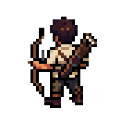

### PL-02-2+quick-bow-shot@east ·  (2026-11-17)

### PL-02-2+quick-bow-shot@west ·  (2026-11-17)

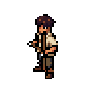

### PL-02-2+aimed-bow-shot@south ·  (2026-11-17)

### PL-02-2+aimed-bow-shot@north ·  (2026-11-17)

### PL-02-2+aimed-bow-shot@east ·  (2026-11-17)

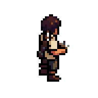

### PL-02-2+aimed-bow-shot@west ·  (2026-11-17)

### NP-02-1 · Caedan Ashvale (2026-11-17) ✓ approved

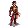

a regal, charismatic young prince standing tall and proud, crimson and black royal coat richly embroidered with gold, black obsidian shoulder plates, gold sash, short dark hair, confident commanding smile, small flame floating above one palm, from the Ashkara region of the world of Veyra. Single cha

### NP-02-2 · Caedan Ashvale (2026-11-17)

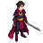

a powerful, commanding young prince in black and crimson lamellar half-armor over a royal coat, thin gold circlet, long flowing red cape, one hand resting on a sword hilt, short dark hair, intense charismatic gaze, from the Ashkara region of the world of Veyra. Single character sprite, facing south-

### NP-02-3 · Caedan Ashvale (2026-11-17)

a powerful young fire-mage prince in long crimson robes with ember-orange trim and gold embroidery, black obsidian pauldrons, gold sash and crown-like circlet, short dark hair, regal stance, flames swirling around one raised hand, from the Ashkara region of the world of Veyra. Single character sprit

### NP-07-2 · Warden Kesh and Surveyor Iven (2026-11-17)

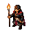 

Made from approved/NP-07-1.png: the same character redrawn at the game's hero scale: much smaller, about 32 px tall and 17 px wide, feet at bottom centre (24, 40) of the 48x48 canvas, same outfit and colours, chunky readable pixels with a dark outline like the hero, no ground shadow, facing south-east

### NP-08-2 · Sela and Keeper Amaru (2026-11-17)

 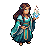

Made from approved/NP-08-1.png: the same character redrawn at the game's hero scale: much smaller, about 32 px tall and 17 px wide, feet at bottom centre (24, 40) of the 48x48 canvas, same outfit and colours, chunky readable pixels with a dark outline like the hero, no ground shadow, facing south-east

### NP-07-3 · Warden Kesh and Surveyor Iven (2026-11-17)

 

Made from approved/NP-07-1.png: clean up this small pixel-art character: same character, same pose, same size and position (about 32 px tall, feet at (24, 40)), crisp hand-placed pixels, clear readable face and outfit, dark outline like the game's hero, no ground shadow, facing south-east

### NP-08-3 · Sela and Keeper Amaru (2026-11-17)

 

Made from approved/NP-08-1.png: clean up this small pixel-art character: same character, same pose, same size and position (about 32 px tall, feet at (24, 40)), crisp hand-placed pixels, clear readable face and outfit, dark outline like the game's hero, no ground shadow, facing south-east

### NP-02-4 · Caedan Ashvale (2026-11-17)

 

Made from approved/NP-02-3.png: clean up this small pixel-art prince: same character, same outfit and colours, same size and position (about 32 px tall, feet at (24, 40)), remove the fire from his raised hand so the hand is empty with no flames or glow anywhere, crisp hand-placed pixels, clear readable face, dark outline like the 

### NP-07-1+8dir · Warden Kesh and Surveyor Iven (2026-11-17)

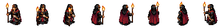

Made from approved/NP-07-1.png: 8 directions of the approved picture

### NP-07-1+idle · Warden Kesh and Surveyor Iven (2026-11-17)

Made from approved/NP-07-1.png: idle

### NP-07-1+talking · Warden Kesh and Surveyor Iven (2026-11-17)

Made from approved/NP-07-1.png: talking

### NP-08-1+8dir · Sela and Keeper Amaru (2026-11-17)

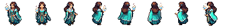

Made from approved/NP-08-1.png: 8 directions of the approved picture

### NP-08-1+idle · Sela and Keeper Amaru (2026-11-17)

Made from approved/NP-08-1.png: idle

### NP-08-1+talking · Sela and Keeper Amaru (2026-11-17)

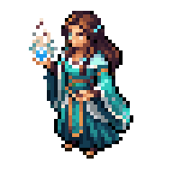

Made from approved/NP-08-1.png: talking

### NP-08-1+heal-cast · Sela and Keeper Amaru (2026-11-17)

Made from approved/NP-08-1.png: heal cast

### PL-02-1+8dir ·  (2026-11-16)

### PL-02-2+8dir ·  (2026-11-16)

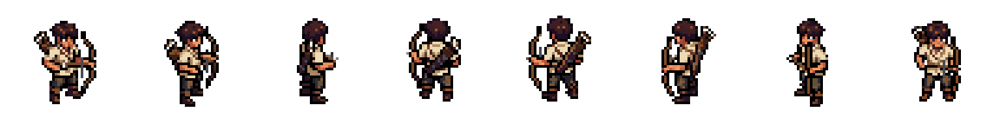

### PL-01-1+idle@south-west ·  (2026-11-16)

### PL-01-1+walk@south-west ·  (2026-11-16)

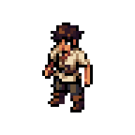

### PL-01-1+cast@south-west ·  (2026-11-16)

### PL-01-1+getting-hit@south-west ·  (2026-11-16)

### PL-01-1+death@south-west ·  (2026-11-16)

### PL-01-1+downed@south-west ·  (2026-11-16)

### PL-01-1+revived@south-west ·  (2026-11-16)

### PL-01-1+idle@north-west ·  (2026-11-16)

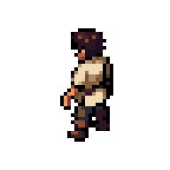

### PL-01-1+walk@north-west ·  (2026-11-16)

### PL-01-1+cast@north-west ·  (2026-11-16)

### PL-01-1+getting-hit@north-west ·  (2026-11-16)

### PL-01-1+death@north-west ·  (2026-11-16)

### PL-01-1+downed@north-west ·  (2026-11-16)

### PL-01-1+revived@north-west ·  (2026-11-16)

### PL-01-1+idle@north-east ·  (2026-11-16)

### PL-01-1+walk@north-east ·  (2026-11-16)

### PL-01-1+cast@north-east ·  (2026-11-16)

### PL-01-1+getting-hit@north-east ·  (2026-11-16)

### PL-01-1+death@north-east ·  (2026-11-16)

### PL-01-1+downed@north-east ·  (2026-11-16)

### PL-01-1+revived@north-east ·  (2026-11-16)

### PL-02-1+sword-slash ·  (2026-11-16)

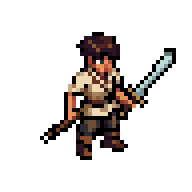

### PL-02-1+sword-slash@south-west ·  (2026-11-16)

### PL-02-1+sword-slash@north-west ·  (2026-11-16)

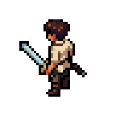

### PL-02-1+sword-slash@north-east ·  (2026-11-16)

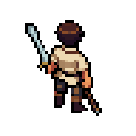

### PL-02-1+sword-lunge ·  (2026-11-16)

### PL-02-1+sword-lunge@south-west ·  (2026-11-16)

### PL-02-1+sword-lunge@north-west ·  (2026-11-16)

### PL-02-1+sword-lunge@north-east ·  (2026-11-16)

### PL-02-2+quick-bow-shot ·  (2026-11-16)

### PL-02-2+quick-bow-shot@south-west ·  (2026-11-16)

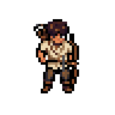

### PL-02-2+quick-bow-shot@north-west ·  (2026-11-16)

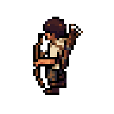

### PL-02-2+quick-bow-shot@north-east ·  (2026-11-16)

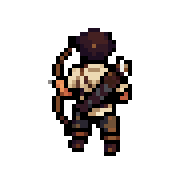

### PL-02-2+aimed-bow-shot ·  (2026-11-16)

### PL-02-2+aimed-bow-shot@south-west ·  (2026-11-16)

### PL-02-2+aimed-bow-shot@north-west ·  (2026-11-16)

### PL-02-2+aimed-bow-shot@north-east ·  (2026-11-16)

### BO-02-1 · Ashbark Colossus (2026-11-15)

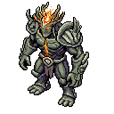

an ancient giant made of ash-grey bark and smouldering branches, glowing ember core. Single sprite, facing south-east (front three-quarter isometric view), full body, about 90 px tall on a 128x128 canvas, idle pose. pixel art, isometric 2:1 view, no dark outline (edges come from shading and a darker

### BO-03-1 · Riverwyrm (2026-11-15)

a colossal green-and-gold anaconda-like river serpent, crowned with fins, from the Tidereach region of the world of Veyra. Single character sprite, facing south-east (front three-quarter isometric view), full body, large creature on a 96x96 canvas, idle standing pose. pixel art, isometric 2:1 view, 

### BO-04-1 · First Ashvale (spirit) (2026-11-15)

a ghostly ancient king, translucent blue-white, obsidian crown, burning Sunstone sceptre. Single sprite, facing south-east (front three-quarter isometric view), full body, about 90 px tall on a 128x128 canvas, idle pose. pixel art, isometric 2:1 view, no dark outline (edges come from shading and a d

### BO-06-2 · Caedan with Stillheart (2026-11-15)

a jagged black crystal sword with grey smoke aura and drained colored sparks. Game spell/attack effect sprite, isometric view, glowing, bright readable colors, 64x64 canvas. pixel art, isometric 2:1 view, no dark outline (edges come from shading and a darker tone of each part's own colour, not black

### EN-03-1 · Salamander hounds (2026-11-15)

a lean red salamander-like hound with glowing orange spots and a smoking tail, from the Ashkara region of the world of Veyra. Single character sprite, facing south-east (front three-quarter isometric view), full body, small to medium creature on a 48x48 canvas, idle standing pose. pixel art, isometr

### EN-04-1 · Cinder vultures (2026-11-15)

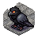

a black vulture with ash-grey wingtips and glowing ember eyes, from the Ashkara region of the world of Veyra. Single character sprite, facing south-east (front three-quarter isometric view), full body, small to medium creature on a 48x48 canvas, idle standing pose. pixel art, isometric 2:1 view, no 

### EN-05-1 · Moon jaguars (2026-11-15)

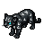

a black jaguar with silver moon-shaped rosettes and glowing blue eyes, from the Tidereach region of the world of Veyra. Single character sprite, facing south-east (front three-quarter isometric view), full body, small to medium creature on a 48x48 canvas, idle standing pose. pixel art, isometric 2:1

### EN-06-1 · Crown harpies (2026-11-15)

a giant harpy eagle with a grey crest crown and powerful talons, from the Tidereach region of the world of Veyra. Single character sprite, facing south-east (front three-quarter isometric view), full body, small to medium creature on a 48x48 canvas, idle standing pose. pixel art, isometric 2:1 view,

### EN-07-1 · Stone sentinels (2026-11-15)

a hulking stone golem guardian carved with clan runes, glowing amber eyes, from the Bedrun region of the world of Veyra. Single character sprite, facing south-east (front three-quarter isometric view), full body, small to medium creature on a 48x48 canvas, idle standing pose. pixel art, isometric 2:

### EN-08-1 · Summons: windmane, sky eagle, ghost leopard, Sunstone construct (2026-11-15)

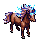

a stocky steppe horse with a long mane that streams like wind and crackles with blue sparks, from the Vael region of the world of Veyra. Single character sprite, facing south-east (front three-quarter isometric view), full body, small to medium creature on a 48x48 canvas, idle standing pose. pixel a

### EN-08-2 · Summons: windmane, sky eagle, ghost leopard, Sunstone construct (2026-11-15)

a huge golden eagle with wings spread wide, from the Vael region of the world of Veyra. Single character sprite, facing south-east (front three-quarter isometric view), full body, small to medium creature on a 48x48 canvas, idle standing pose. pixel art, isometric 2:1 view, no dark outline (edges co

### NP-07-1 · Warden Kesh and Surveyor Iven (2026-11-15) ✓ approved

two Ashkarans: a scarred burn-master in soot-black leathers with a torch-staff, and a surveyor in red robes with a map tube. Single sprite, facing south-east (front three-quarter isometric view), full body, about 32 px tall and 16 px wide, feet at bottom centre (24, 40) of a 48x48 canvas, idle pose.

### NP-08-1 · Sela and Keeper Amaru (2026-11-15) ✓ approved

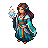

a calm middle-aged healer woman, teal and white flowing wraps, braided hair with river beads, small glowing water orb in hand, from the Tidereach region of the world of Veyra. Single character sprite, facing south-east (front three-quarter isometric view), full body, about 32 px tall and 16 px wide,

### NP-09-1 · Thane Orvek (2026-11-15)

a broad elderly earth-clan chieftain, thick white braided beard, stone-plate armor, barefoot, huge forearms, from the Bedrun region of the world of Veyra. Single character sprite, facing south-east (front three-quarter isometric view), full body, about 32 px tall and 16 px wide, feet at bottom centr

### NP-10-1 · Brother Wend (2026-11-15)

a thin elderly monk, shaved head, saffron robes over a grey felt coat, prayer beads, serene closed eyes, from the Vael region of the world of Veyra. Single character sprite, facing south-east (front three-quarter isometric view), full body, about 32 px tall and 16 px wide, feet at bottom centre (24,

### NP-11-1 · Captain Tavi Rhal (2026-11-15)

a disciplined Ember Hand officer woman, black and crimson lamellar armor, glaive, red plume. Single sprite, facing south-east (front three-quarter isometric view), full body, about 32 px tall and 16 px wide, feet at bottom centre (24, 40) of a 48x48 canvas, idle pose. pixel art, isometric 2:1 view, 

### WO-05-1 · Emberhold + Ash Forests + Heartwood Pyre (2026-11-15)

an obsidian palace with red banners, sharp black towers and gold braziers, from the Ashkara region of the world of Veyra. Isometric game tiles/props for a 32x16 isometric grid (blocks 32 px wide with 16 px side faces), seamless edges, several variants. pixel art, isometric 2:1 view, limited palette,

### WO-05-2 · Emberhold + Ash Forests + Heartwood Pyre (2026-11-15)

three versions of a tall ash tree: healthy with orange leaves, burning, and charred black, from the Ashkara region of the world of Veyra. Isometric game tiles/props for a 32x16 isometric grid (blocks 32 px wide with 16 px side faces), seamless edges, several variants. pixel art, isometric 2:1 view, 

### WO-06-1 · Lunhaven + Lowlands + Drowned Dig (2026-11-15)

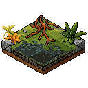

flooded jungle floor tiles with roots, mud and shallow dark water, from the Tidereach region of the world of Veyra. Isometric game tiles/props for a 32x16 isometric grid (blocks 32 px wide with 16 px side faces), seamless edges, several variants. pixel art, isometric 2:1 view, limited palette, soft 

### WO-06-2 · Lunhaven + Lowlands + Drowned Dig (2026-11-15)

a giant kapok tree with buttress roots and a rope canopy walkway, from the Tidereach region of the world of Veyra. Isometric game tiles/props for a 32x16 isometric grid (blocks 32 px wide with 16 px side faces), seamless edges, several variants. pixel art, isometric 2:1 view, limited palette, soft l

### WO-07-1 · Underdeep (Bedru's Heart) (2026-11-15)

cave tiles with glowing teal lichen and tall purple crystal clusters, from the Bedrun region of the world of Veyra. Isometric game tiles/props for a 32x16 isometric grid (blocks 32 px wide with 16 px side faces), seamless edges, several variants. pixel art, isometric 2:1 view, limited palette, soft 

### WO-08-1 · Ice Spine monasteries + Stillpoint (2026-11-15)

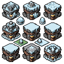

frozen mountain rock blocks with ice and snow caps, from the Vael region of the world of Veyra. Isometric game tiles/props for a 32x16 isometric grid (blocks 32 px wide with 16 px side faces), seamless edges, several variants. pixel art, isometric 2:1 view, limited palette, soft light from top-left,

### WO-08-2 · Ice Spine monasteries + Stillpoint (2026-11-15)

a cliffside monastery with red-gold roofs and a hall of hanging bronze wind chimes, from the Vael region of the world of Veyra. Isometric game tiles/props for a 32x16 isometric grid (blocks 32 px wide with 16 px side faces), seamless edges, several variants. pixel art, isometric 2:1 view, limited pa

### WO-09-1 · High Calderas + Caldera Nest (2026-11-15)

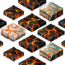

black volcanic obsidian ground tiles and glassy cliff blocks with orange glow cracks, from the Ashkara region of the world of Veyra. Isometric game tiles/props for a 32x16 isometric grid (blocks 32 px wide with 16 px side faces), seamless edges, several variants. pixel art, isometric 2:1 view, limit

### WO-09-2 · High Calderas + Caldera Nest (2026-11-15)

molten lava tiles and lava river with cooled dark crust edges, from the Ashkara region of the world of Veyra. Isometric game tiles/props for a 32x16 isometric grid (blocks 32 px wide with 16 px side faces), seamless edges, several variants. pixel art, isometric 2:1 view, limited palette, soft light 

### PL-01-1+idle · Hero base body (2026-11-15)

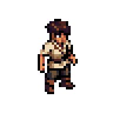

Made from approved/PL-01-1.png: idle

### PL-01-1+walk · Hero base body (2026-11-15)

Made from approved/PL-01-1.png: walk

### PL-01-1+cast · Hero base body (2026-11-15)

Made from approved/PL-01-1.png: cast

### PL-01-1+getting-hit · Hero base body (2026-11-15)

Made from approved/PL-01-1.png: getting hit

### PL-01-1+death · Hero base body (2026-11-15)

   

Made from approved/PL-01-1.png: death

### PL-01-1+downed · Hero base body (2026-11-15)

Made from approved/PL-01-1.png: downed

### PL-01-1+revived · Hero base body (2026-11-15)

Made from approved/PL-01-1.png: revived

### BO-01-1 · The Foreman + Grey Heart (2026-11-14)

a hulking corrupted miner boss, grey cracked skin, glowing Sunstone shards in his back, giant pick-hammer, from the Bedrun region of the world of Veyra. Single character sprite, facing south-east (front three-quarter isometric view), full body, large creature on a 96x96 canvas, idle standing pose. p

### BO-01-2 · The Foreman + Grey Heart (2026-11-14)

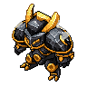

a large floating crystal of black-gold Sunstone, cracked, pulsing with grey smoke, from the Bedrun region of the world of Veyra. Single character sprite, facing south-east (front three-quarter isometric view), full body, large creature on a 96x96 canvas, idle standing pose. pixel art, isometric 2:1 

### EN-02-1 · Human husks (+ Ember Hand soldier reskin) (2026-11-14)

Ashkaran soldier in black and crimson lamellar armor with a glaive, and a Crucible student in red robes, from the Ashkara region of the world of Veyra. Single character sprite, facing south-east (front three-quarter isometric view), full body, about 32 px tall and 16 px wide, feet at bottom centre (

### FX-04-1 · Air effects (2026-11-14)

a palm-shaped gust of white wind lines. Game spell/attack effect sprite, isometric view, glowing, bright readable colors, 64x64 canvas. pixel art, isometric 2:1 view, limited palette, soft light from top-left, transparent background, high-fantasy RPG style.

### FX-04-2 · Air effects (2026-11-14)

a small swirling tornado with debris. Game spell/attack effect sprite, isometric view, glowing, bright readable colors, 64x64 canvas. pixel art, isometric 2:1 view, limited palette, soft light from top-left, transparent background, high-fantasy RPG style.

### IC-03-1 · Armor, consumables, materials, quest items, rarity frames (2026-11-14)

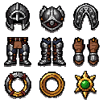

armor icons: helmet, chestplate, leggings, boots, gloves, ring, amulet. Inventory icons, each 32x32, front view centered, bold silhouette, slight drop shadow. Pixel art, limited palette, transparent background, high-fantasy RPG style.

### IC-03-2 · Armor, consumables, materials, quest items, rarity frames (2026-11-14)

a red health potion and a blue mana potion in glass flasks. Inventory icons, each 32x32, front view centered, bold silhouette, slight drop shadow. Pixel art, limited palette, transparent background, high-fantasy RPG style.

### NP-05-1 · Generic townsfolk (recolor per region) (2026-11-14)

a set of townsfolk: merchant with apron, town guard with spear, quest-giver elder with cane, from the Crossing region of the world of Veyra. Single character sprite, facing south-east (front three-quarter isometric view), full body, about 32 px tall and 16 px wide, feet at bottom centre (24, 40) of 

### NP-05-2 · Generic townsfolk (recolor per region) (2026-11-14)

three guild members: a swordmaster in a blue dueling coat, a hooded ranger in green with a bow, a burly smith with a hammer and leather apron, from the Crossing region of the world of Veyra. Single character sprite, facing south-east (front three-quarter isometric view), full body, about 32 px tall 

### NP-06-1 · Sovereign Ilsar (2026-11-14)

a stern older king, greying beard, heavy crimson and black robes, obsidian crown, imposing posture, from the Ashkara region of the world of Veyra. Single character sprite, facing south-east (front three-quarter isometric view), full body, about 32 px tall and 16 px wide, feet at bottom centre (24, 4

### UI-03-1 · Dialogue box + portraits (12 quest givers) (2026-11-14)

a dialogue text box with a name plate and portrait slot, wood and parchment. Game UI element, pixel art, crisp edges, readable at 1x, limited palette, high-fantasy RPG style, transparent background.

### UI-03-2 · Dialogue box + portraits (12 quest givers) (2026-11-14)

Close-up bust portraits, 64x64 each, of: a young prince in a red-black coat (Caedan) in three moods (warm, troubled, cold and grey); a calm teal-robed healer woman; an old bearded earth chieftain; an elderly saffron-robed monk; a stern crowned king. Pixel art, limited palette, soft light, high-fanta

### UI-04-1 · Title, logo, fonts, nation emblems (2026-11-14)

game logo text 'VEYRA' with four element symbols (flame, stone, wave, wind). Game UI element, pixel art, crisp edges, readable at 1x, limited palette, high-fantasy RPG style, transparent background.

### UI-04-2 · Title, logo, fonts, nation emblems (2026-11-14)

readable pixel font, uppercase and lowercase alphabet. Game UI element, pixel art, crisp edges, readable at 1x, limited palette, high-fantasy RPG style, transparent background.

### WO-02-1 · Millbrook + the Crossing (guild hall, quest boards, respawn shrine) (2026-11-14)

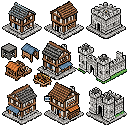

medieval market-town buildings: timber inn, market stalls with awnings, stone city wall and gate, from the Crossing region of the world of Veyra. Isometric game tiles/props for a 32x16 isometric grid (blocks 32 px wide with 16 px side faces), seamless edges, several variants. pixel art, isometric 2:

### WO-02-2 · Millbrook + the Crossing (guild hall, quest boards, respawn shrine) (2026-11-14)

three guild buildings: a fencing hall with crossed-swords banner, a ranger lodge of logs, a stone forge with chimney, from the Crossing region of the world of Veyra. Isometric game tiles/props for a 32x16 isometric grid (blocks 32 px wide with 16 px side faces), seamless edges, several variants. pix

### WO-03-1 · Deepcut + Silent Shaft + Clan Halls (2026-11-14)

red sandstone canyon cliff blocks and green terraced farm steps, from the Bedrun region of the world of Veyra. Isometric game tiles/props for a 32x16 isometric grid (blocks 32 px wide with 16 px side faces), seamless edges, several variants. pixel art, isometric 2:1 view, limited palette, soft light

### WO-03-2 · Deepcut + Silent Shaft + Clan Halls (2026-11-14)

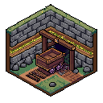

a timber mine entrance with rail track and cart, rock wall with glowing gold Sunstone seams, from the Bedrun region of the world of Veyra. Isometric game tiles/props for a 32x16 isometric grid (blocks 32 px wide with 16 px side faces), seamless edges, several variants. pixel art, isometric 2:1 view,

### WO-04-1 · Windsteppe camps (gers, cairns, snow) (2026-11-14)

cold steppe grass tiles and snow-covered grass tiles, from the Vael region of the world of Veyra. Isometric game tiles/props for a 32x16 isometric grid (blocks 32 px wide with 16 px side faces), seamless edges, several variants. pixel art, isometric 2:1 view, limited palette, soft light from top-lef

### WO-04-2 · Windsteppe camps (gers, cairns, snow) (2026-11-14)

a round white felt nomad tent with a wooden door and smoke hole, from the Vael region of the world of Veyra. Isometric game tiles/props for a 32x16 isometric grid (blocks 32 px wide with 16 px side faces), seamless edges, several variants. pixel art, isometric 2:1 view, limited palette, soft light f

### NP-03-1 · Steward Brann (2026-11-09)

a portly mine steward, dusty waistcoat, ledger, lamp at belt, smug expression. Single sprite, facing south-east (front three-quarter isometric view), full body, about 32 px tall and 16 px wide, feet at bottom centre (24, 40) of a 48x48 canvas, idle pose. pixel art, isometric 2:1 view, no dark outlin

### NP-04-1 · Saran (2026-11-09)

a weathered steppe clan matriarch, fur-lined felt coat, silver headdress, walking staff. Single sprite, facing south-east (front three-quarter isometric view), full body, about 32 px tall and 16 px wide, feet at bottom centre (24, 40) of a 48x48 canvas, idle pose. pixel art, isometric 2:1 view, no d

### UI-02-1 · Menus: character, ability tree, inventory, quest log (2026-11-08)

a parchment-and-wood character panel with equipment slots around a silhouette. Game UI element, pixel art, crisp edges, readable at 1x, limited palette, high-fantasy RPG style, transparent background.

### UI-02-2 · Menus: character, ability tree, inventory, quest log (2026-11-08)

an ability tree panel with tiered icon slots and connecting lines on dark parchment. Game UI element, pixel art, crisp edges, readable at 1x, limited palette, high-fantasy RPG style, transparent background.

### PL-03-1 · Armor layers (4 nation styles) (2026-11-08)

 

Made from approved/PL-01-1.png: wearing an armor set of crimson Crucible robes with ember-orange trim, black obsidian shoulder plates and a gold sash (Ashkara)

### PL-03-2 · Armor layers (4 nation styles) (2026-11-08)

 

Made from approved/PL-01-1.png: wearing an armor set of heavy stone-grey plate with leather straps, a miner's helmet with a lamp and ochre cloth (Bedrun)

### NP-01-1 · Maren Voss (2026-11-08)

a sharp-eyed Floor Guild recruiter woman, blue guild coat, clipboard, short auburn hair. Single sprite, facing south-east (front three-quarter isometric view), full body, about 32 px tall and 16 px wide, feet at bottom centre (24, 40) of a 48x48 canvas, idle pose. pixel art, isometric 2:1 view, no d

### FX-06-1 · General: hit sparks, status loops, telegraphs, level-up (2026-11-07)

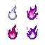

set of small hit sparks: white physical spark, purple magic burst. Game spell/attack effect sprite, isometric view, glowing, bright readable colors, 64x64 canvas. pixel art, isometric 2:1 view, limited palette, soft light from top-left, transparent background, high-fantasy RPG style.

### FX-06-2 · General: hit sparks, status loops, telegraphs, level-up (2026-11-07)

small looping icons above a head: stun stars, root vines, slow snail swirl, silence bubble, sleep Zzz, burn flame, bleed drops, poison bubbles. Game spell/attack effect sprite, isometric view, glowing, bright readable colors, 64x64 canvas. pixel art, isometric 2:1 view, limited palette, soft light f

### IC-04-1 · Buff and debuff icons (2026-11-07)

set of small round buff and debuff icons. Inventory icons, each 32x32, front view centered, bold silhouette, slight drop shadow. Pixel art, limited palette, transparent background, high-fantasy RPG style.

### UI-01-1 · HUD: action bar, unit frames, numbers, minimap (2026-11-07)

a fantasy action bar with 10 square slots, stone-and-bronze frame. Game UI element, pixel art, crisp edges, readable at 1x, limited palette, high-fantasy RPG style, transparent background.

### UI-01-2 · HUD: action bar, unit frames, numbers, minimap (2026-11-07)

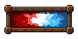

a portrait frame with red health bar and blue mana bar, bronze trim. Game UI element, pixel art, crisp edges, readable at 1x, limited palette, high-fantasy RPG style, transparent background.

### WO-01-1 · Base tileset + plants + props + lights (2026-11-06)

props set: wooden chest, barrel, crate, signpost, table and stool. Isometric game tiles/props for a 32x16 isometric grid (blocks 32 px wide with 16 px side faces), seamless edges, several variants. pixel art, isometric 2:1 view, limited palette, soft light from top-left, transparent background, high

### WO-01-2 · Base tileset + plants + props + lights (2026-11-06)

props set: wall torch, standing lamp, brazier, glowing gold Sunstone lamp. Isometric game tiles/props for a 32x16 isometric grid (blocks 32 px wide with 16 px side faces), seamless edges, several variants. pixel art, isometric 2:1 view, limited palette, soft light from top-left, transparent backgrou

### FX-01-2 · Fire effects (2026-11-06)

a whip of fire, a straight stream of flame and a cone of fire breath. Game spell/attack effect sprite, isometric view, glowing, bright readable colors, 64x64 canvas. pixel art, isometric 2:1 view, limited palette, soft light from top-left, transparent background, high-fantasy RPG style.

### PL-01-1 · Hero base body (2026-11-06) ✓ approved

 

a young adventurer in a plain linen tunic, trousers and boots, short hair, neutral build, no weapon, ready for gear to be layered on. Single character sprite, facing south-east (front three-quarter isometric view), full body, about 32 px tall and 16 px wide, feet at bottom centre (24, 40) of a 48x48

### PL-01-1+8dir · Hero base body (2026-11-06)

 

Made from approved/PL-01-1.png: 8 directions of the approved picture

### PL-01-2 · Hero base body (2026-11-06)

 

Made from approved/PL-01-1.png: empty-handed, in a martial-arts bending stance

### PL-02-1 · Weapon attacks: sword, bow, hammer (2026-11-06)

 

Made from approved/PL-01-1.png: holding a one-handed sword

### PL-02-2 · Weapon attacks: sword, bow, hammer (2026-11-06)

 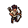

Made from approved/PL-01-1.png: holding a recurve bow and quiver

### FX-01-1 · Fire effects (2026-11-06)

9 small bursts of fire from a punch and a kick, each shooting sideways (horizontally), each no bigger than 16x16 pixels, arranged in a 3x3 grid with empty space between them, each one slightly different. Game spell/attack effect sprite, isometric view, glowing, bright readable colors, 64x64 canvas. 

### FX-02-1 · Earth effects (2026-11-06)

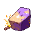

a spinning rock chunk with dust trail. Game spell/attack effect sprite, isometric view, glowing, bright readable colors, 64x64 canvas. pixel art, isometric 2:1 view, limited palette, soft light from top-left, transparent background, high-fantasy RPG style.

### FX-02-2 · Earth effects (2026-11-06)

ground cracks spreading with dust and pebbles. Game spell/attack effect sprite, isometric view, glowing, bright readable colors, 64x64 canvas. pixel art, isometric 2:1 view, limited palette, soft light from top-left, transparent background, high-fantasy RPG style.

### FX-03-1 · Water effects (2026-11-06)

a whip of clear water, a high-pressure water jet and a rolling wave. Game spell/attack effect sprite, isometric view, glowing, bright readable colors, 64x64 canvas. pixel art, isometric 2:1 view, limited palette, soft light from top-left, transparent background, high-fantasy RPG style.

### FX-03-2 · Water effects (2026-11-06)

rising green-blue healing sparkles and soft mist. Game spell/attack effect sprite, isometric view, glowing, bright readable colors, 64x64 canvas. pixel art, isometric 2:1 view, limited palette, soft light from top-left, transparent background, high-fantasy RPG style.

### FX-05-1 · Weapon effects: slash, parry, dash, arrows, traps, slam (2026-11-06)

a bright crescent sword slash arc. Game spell/attack effect sprite, isometric view, glowing, bright readable colors, 64x64 canvas. pixel art, isometric 2:1 view, limited palette, soft light from top-left, transparent background, high-fantasy RPG style.

### FX-05-2 · Weapon effects: slash, parry, dash, arrows, traps, slam (2026-11-06)

a sharp white spark flash from blades clashing. Game spell/attack effect sprite, isometric view, glowing, bright readable colors, 64x64 canvas. pixel art, isometric 2:1 view, limited palette, soft light from top-left, transparent background, high-fantasy RPG style.

