# Art drafts

Made by the art bot (`tools/art_bot/` on the main branch) from the art tracker's prompts.
27 of 73 stills done. Newest first. These are drafts: copy the
keepers into the game's `assets/` folder by hand.

**To build on a draft** (new weapon or outfit, 8 directions, animations), copy it to
`approved/<KEY>.png` on this branch, for example `approved/PL-01-1.png`.

## Waiting for an approved base

- `approved/NP-02-1.png` unlocks BO-06-1

## Approve to animate

- `approved/PL-02-1.png` unlocks 8 directions, sword slash, sword lunge
- `approved/PL-02-2.png` unlocks 8 directions, quick bow shot, aimed bow shot
- `approved/NP-01-1.png` unlocks 8 directions, idle, talking
- `approved/NP-02-1.png` unlocks 8 directions, idle, walk, talking, fire cast
- `approved/NP-03-1.png` unlocks 8 directions, idle, talking
- `approved/NP-04-1.png` unlocks 8 directions, idle, talking

## Drafts

### NP-02-1 · Caedan Ashvale (2026-11-09)

a charismatic young prince, red-black royal coat with gold trim, short dark hair, warm confident expression, small flame floating above one palm, from the Ashkara region of the world of Veyra. Single character sprite, facing south-east (front three-quarter isometric view), full body, about 32 px tal

### NP-03-1 · Steward Brann (2026-11-09)

a portly mine steward, dusty waistcoat, ledger, lamp at belt, smug expression. Single sprite, facing south-east (front three-quarter isometric view), full body, about 32 px tall and 16 px wide, feet at bottom centre (24, 40) of a 48x48 canvas, idle pose. pixel art, isometric 2:1 view, no dark outlin

### NP-04-1 · Saran (2026-11-09)

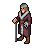

a weathered steppe clan matriarch, fur-lined felt coat, silver headdress, walking staff. Single sprite, facing south-east (front three-quarter isometric view), full body, about 32 px tall and 16 px wide, feet at bottom centre (24, 40) of a 48x48 canvas, idle pose. pixel art, isometric 2:1 view, no d

### UI-02-1 · Menus: character, ability tree, inventory, quest log (2026-11-08)

a parchment-and-wood character panel with equipment slots around a silhouette. Game UI element, pixel art, crisp edges, readable at 1x, limited palette, high-fantasy RPG style, transparent background.

### UI-02-2 · Menus: character, ability tree, inventory, quest log (2026-11-08)

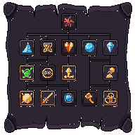

an ability tree panel with tiered icon slots and connecting lines on dark parchment. Game UI element, pixel art, crisp edges, readable at 1x, limited palette, high-fantasy RPG style, transparent background.

### PL-03-1 · Armor layers (4 nation styles) (2026-11-08)

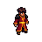 

Made from approved/PL-01-1.png: wearing an armor set of crimson Crucible robes with ember-orange trim, black obsidian shoulder plates and a gold sash (Ashkara)

### PL-03-2 · Armor layers (4 nation styles) (2026-11-08)

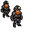 

Made from approved/PL-01-1.png: wearing an armor set of heavy stone-grey plate with leather straps, a miner's helmet with a lamp and ochre cloth (Bedrun)

### NP-01-1 · Maren Voss (2026-11-08)

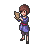

a sharp-eyed Floor Guild recruiter woman, blue guild coat, clipboard, short auburn hair. Single sprite, facing south-east (front three-quarter isometric view), full body, about 32 px tall and 16 px wide, feet at bottom centre (24, 40) of a 48x48 canvas, idle pose. pixel art, isometric 2:1 view, no d

### FX-06-1 · General: hit sparks, status loops, telegraphs, level-up (2026-11-07)

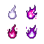

set of small hit sparks: white physical spark, purple magic burst. Game spell/attack effect sprite, isometric view, glowing, bright readable colors, 64x64 canvas. pixel art, isometric 2:1 view, limited palette, soft light from top-left, transparent background, high-fantasy RPG style.

### FX-06-2 · General: hit sparks, status loops, telegraphs, level-up (2026-11-07)

small looping icons above a head: stun stars, root vines, slow snail swirl, silence bubble, sleep Zzz, burn flame, bleed drops, poison bubbles. Game spell/attack effect sprite, isometric view, glowing, bright readable colors, 64x64 canvas. pixel art, isometric 2:1 view, limited palette, soft light f

### IC-04-1 · Buff and debuff icons (2026-11-07)

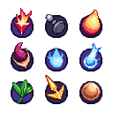

set of small round buff and debuff icons. Inventory icons, each 32x32, front view centered, bold silhouette, slight drop shadow. Pixel art, limited palette, transparent background, high-fantasy RPG style.

### UI-01-1 · HUD: action bar, unit frames, numbers, minimap (2026-11-07)

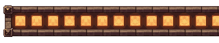

a fantasy action bar with 10 square slots, stone-and-bronze frame. Game UI element, pixel art, crisp edges, readable at 1x, limited palette, high-fantasy RPG style, transparent background.

### UI-01-2 · HUD: action bar, unit frames, numbers, minimap (2026-11-07)

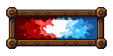

a portrait frame with red health bar and blue mana bar, bronze trim. Game UI element, pixel art, crisp edges, readable at 1x, limited palette, high-fantasy RPG style, transparent background.

### WO-01-1 · Base tileset + plants + props + lights (2026-11-06)

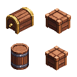

props set: wooden chest, barrel, crate, signpost, table and stool. Isometric game tiles/props for a 32x16 isometric grid (blocks 32 px wide with 16 px side faces), seamless edges, several variants. pixel art, isometric 2:1 view, limited palette, soft light from top-left, transparent background, high

### WO-01-2 · Base tileset + plants + props + lights (2026-11-06)

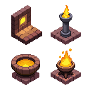

props set: wall torch, standing lamp, brazier, glowing gold Sunstone lamp. Isometric game tiles/props for a 32x16 isometric grid (blocks 32 px wide with 16 px side faces), seamless edges, several variants. pixel art, isometric 2:1 view, limited palette, soft light from top-left, transparent backgrou

### FX-01-2 · Fire effects (2026-11-06)

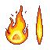

a whip of fire, a straight stream of flame and a cone of fire breath. Game spell/attack effect sprite, isometric view, glowing, bright readable colors, 64x64 canvas. pixel art, isometric 2:1 view, limited palette, soft light from top-left, transparent background, high-fantasy RPG style.

### PL-01-1 · Hero base body (2026-11-06) ✓ approved

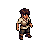 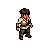

a young adventurer in a plain linen tunic, trousers and boots, short hair, neutral build, no weapon, ready for gear to be layered on. Single character sprite, facing south-east (front three-quarter isometric view), full body, about 32 px tall and 16 px wide, feet at bottom centre (24, 40) of a 48x48

### PL-01-1+8dir · Hero base body (2026-11-06)

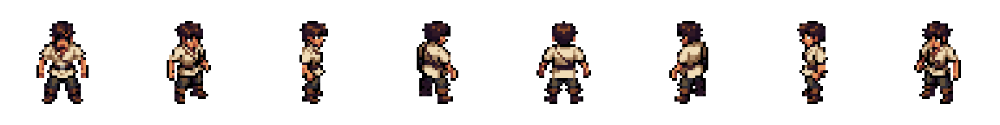 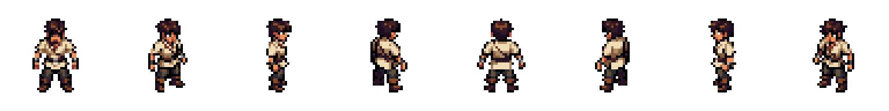

Made from approved/PL-01-1.png: 8 directions of the approved picture

### PL-01-2 · Hero base body (2026-11-06)

 

Made from approved/PL-01-1.png: empty-handed, in a martial-arts bending stance

### PL-02-1 · Weapon attacks: sword, bow, hammer (2026-11-06)

 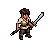

Made from approved/PL-01-1.png: holding a one-handed sword

### PL-02-2 · Weapon attacks: sword, bow, hammer (2026-11-06)

 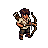

Made from approved/PL-01-1.png: holding a recurve bow and quiver

### FX-01-1 · Fire effects (2026-11-06)

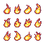

9 small bursts of fire from a punch and a kick, each shooting sideways (horizontally), each no bigger than 16x16 pixels, arranged in a 3x3 grid with empty space between them, each one slightly different. Game spell/attack effect sprite, isometric view, glowing, bright readable colors, 64x64 canvas. 

### FX-02-1 · Earth effects (2026-11-06)

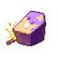

a spinning rock chunk with dust trail. Game spell/attack effect sprite, isometric view, glowing, bright readable colors, 64x64 canvas. pixel art, isometric 2:1 view, limited palette, soft light from top-left, transparent background, high-fantasy RPG style.

### FX-02-2 · Earth effects (2026-11-06)

ground cracks spreading with dust and pebbles. Game spell/attack effect sprite, isometric view, glowing, bright readable colors, 64x64 canvas. pixel art, isometric 2:1 view, limited palette, soft light from top-left, transparent background, high-fantasy RPG style.

### FX-03-1 · Water effects (2026-11-06)

a whip of clear water, a high-pressure water jet and a rolling wave. Game spell/attack effect sprite, isometric view, glowing, bright readable colors, 64x64 canvas. pixel art, isometric 2:1 view, limited palette, soft light from top-left, transparent background, high-fantasy RPG style.

### FX-03-2 · Water effects (2026-11-06)

rising green-blue healing sparkles and soft mist. Game spell/attack effect sprite, isometric view, glowing, bright readable colors, 64x64 canvas. pixel art, isometric 2:1 view, limited palette, soft light from top-left, transparent background, high-fantasy RPG style.

### FX-05-1 · Weapon effects: slash, parry, dash, arrows, traps, slam (2026-11-06)

a bright crescent sword slash arc. Game spell/attack effect sprite, isometric view, glowing, bright readable colors, 64x64 canvas. pixel art, isometric 2:1 view, limited palette, soft light from top-left, transparent background, high-fantasy RPG style.

### FX-05-2 · Weapon effects: slash, parry, dash, arrows, traps, slam (2026-11-06)

a sharp white spark flash from blades clashing. Game spell/attack effect sprite, isometric view, glowing, bright readable colors, 64x64 canvas. pixel art, isometric 2:1 view, limited palette, soft light from top-left, transparent background, high-fantasy RPG style.

