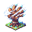
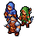
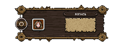
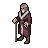
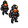
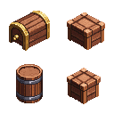
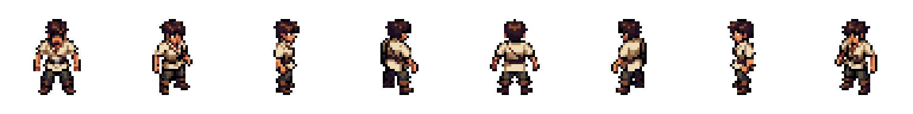

# Art drafts

Made by the art bot (`tools/art_bot/` on the main branch) from the art tracker's prompts.
47 of 73 stills done. Newest first. These are drafts: copy the
keepers into the game's `assets/` folder by hand.

**To build on a draft** (new weapon or outfit, 8 directions, animations), copy it to
`approved/<KEY>.png` on this branch, for example `approved/PL-01-1.png`.

## Waiting for an approved base

- `approved/NP-02-1.png` unlocks BO-06-1

## Approve to animate

- `approved/PL-02-1.png` unlocks 8 directions, sword slash, sword lunge
- `approved/PL-02-2.png` unlocks 8 directions, quick bow shot, aimed bow shot
- `approved/NP-01-1.png` unlocks 8 directions, idle, talking
- `approved/NP-02-1.png` unlocks 8 directions, idle, walk, talking, fire cast
- `approved/NP-03-1.png` unlocks 8 directions, idle, talking
- `approved/NP-04-1.png` unlocks 8 directions, idle, talking
- `approved/NP-05-1.png` unlocks 8 directions, idle, walk, talking
- `approved/NP-05-2.png` unlocks 8 directions, idle, walk, talking
- `approved/EN-02-1.png` unlocks 8 directions, idle, walk, attack, death
- `approved/BO-01-1.png` unlocks 8 directions, idle, attack, winding up a big attack, phase change, death
- `approved/BO-01-2.png` unlocks 8 directions, idle, attack, winding up a big attack, phase change, death
- `approved/NP-06-1.png` unlocks 8 directions, idle, talking

## Drafts

### BO-01-1 · The Foreman + Grey Heart (2026-11-14)

a hulking corrupted miner boss, grey cracked skin, glowing Sunstone shards in his back, giant pick-hammer, from the Bedrun region of the world of Veyra. Single character sprite, facing south-east (front three-quarter isometric view), full body, large creature on a 96x96 canvas, idle standing pose. p

### BO-01-2 · The Foreman + Grey Heart (2026-11-14)

a large floating crystal of black-gold Sunstone, cracked, pulsing with grey smoke, from the Bedrun region of the world of Veyra. Single character sprite, facing south-east (front three-quarter isometric view), full body, large creature on a 96x96 canvas, idle standing pose. pixel art, isometric 2:1 

### EN-02-1 · Human husks (+ Ember Hand soldier reskin) (2026-11-14)

Ashkaran soldier in black and crimson lamellar armor with a glaive, and a Crucible student in red robes, from the Ashkara region of the world of Veyra. Single character sprite, facing south-east (front three-quarter isometric view), full body, about 32 px tall and 16 px wide, feet at bottom centre (

### FX-04-1 · Air effects (2026-11-14)

a palm-shaped gust of white wind lines. Game spell/attack effect sprite, isometric view, glowing, bright readable colors, 64x64 canvas. pixel art, isometric 2:1 view, limited palette, soft light from top-left, transparent background, high-fantasy RPG style.

### FX-04-2 · Air effects (2026-11-14)

a small swirling tornado with debris. Game spell/attack effect sprite, isometric view, glowing, bright readable colors, 64x64 canvas. pixel art, isometric 2:1 view, limited palette, soft light from top-left, transparent background, high-fantasy RPG style.

### IC-03-1 · Armor, consumables, materials, quest items, rarity frames (2026-11-14)

armor icons: helmet, chestplate, leggings, boots, gloves, ring, amulet. Inventory icons, each 32x32, front view centered, bold silhouette, slight drop shadow. Pixel art, limited palette, transparent background, high-fantasy RPG style.

### IC-03-2 · Armor, consumables, materials, quest items, rarity frames (2026-11-14)

a red health potion and a blue mana potion in glass flasks. Inventory icons, each 32x32, front view centered, bold silhouette, slight drop shadow. Pixel art, limited palette, transparent background, high-fantasy RPG style.

### NP-05-1 · Generic townsfolk (recolor per region) (2026-11-14)

a set of townsfolk: merchant with apron, town guard with spear, quest-giver elder with cane, from the Crossing region of the world of Veyra. Single character sprite, facing south-east (front three-quarter isometric view), full body, about 32 px tall and 16 px wide, feet at bottom centre (24, 40) of 

### NP-05-2 · Generic townsfolk (recolor per region) (2026-11-14)

three guild members: a swordmaster in a blue dueling coat, a hooded ranger in green with a bow, a burly smith with a hammer and leather apron, from the Crossing region of the world of Veyra. Single character sprite, facing south-east (front three-quarter isometric view), full body, about 32 px tall 

### NP-06-1 · Sovereign Ilsar (2026-11-14)

a stern older king, greying beard, heavy crimson and black robes, obsidian crown, imposing posture, from the Ashkara region of the world of Veyra. Single character sprite, facing south-east (front three-quarter isometric view), full body, about 32 px tall and 16 px wide, feet at bottom centre (24, 4

### UI-03-1 · Dialogue box + portraits (12 quest givers) (2026-11-14)

a dialogue text box with a name plate and portrait slot, wood and parchment. Game UI element, pixel art, crisp edges, readable at 1x, limited palette, high-fantasy RPG style, transparent background.

### UI-03-2 · Dialogue box + portraits (12 quest givers) (2026-11-14)

Close-up bust portraits, 64x64 each, of: a young prince in a red-black coat (Caedan) in three moods (warm, troubled, cold and grey); a calm teal-robed healer woman; an old bearded earth chieftain; an elderly saffron-robed monk; a stern crowned king. Pixel art, limited palette, soft light, high-fanta

### UI-04-1 · Title, logo, fonts, nation emblems (2026-11-14)

game logo text 'VEYRA' with four element symbols (flame, stone, wave, wind). Game UI element, pixel art, crisp edges, readable at 1x, limited palette, high-fantasy RPG style, transparent background.

### UI-04-2 · Title, logo, fonts, nation emblems (2026-11-14)

readable pixel font, uppercase and lowercase alphabet. Game UI element, pixel art, crisp edges, readable at 1x, limited palette, high-fantasy RPG style, transparent background.

### WO-02-1 · Millbrook + the Crossing (guild hall, quest boards, respawn shrine) (2026-11-14)

medieval market-town buildings: timber inn, market stalls with awnings, stone city wall and gate, from the Crossing region of the world of Veyra. Isometric game tiles/props for a 32x16 isometric grid (blocks 32 px wide with 16 px side faces), seamless edges, several variants. pixel art, isometric 2:

### WO-02-2 · Millbrook + the Crossing (guild hall, quest boards, respawn shrine) (2026-11-14)

three guild buildings: a fencing hall with crossed-swords banner, a ranger lodge of logs, a stone forge with chimney, from the Crossing region of the world of Veyra. Isometric game tiles/props for a 32x16 isometric grid (blocks 32 px wide with 16 px side faces), seamless edges, several variants. pix

### WO-03-1 · Deepcut + Silent Shaft + Clan Halls (2026-11-14)

red sandstone canyon cliff blocks and green terraced farm steps, from the Bedrun region of the world of Veyra. Isometric game tiles/props for a 32x16 isometric grid (blocks 32 px wide with 16 px side faces), seamless edges, several variants. pixel art, isometric 2:1 view, limited palette, soft light

### WO-03-2 · Deepcut + Silent Shaft + Clan Halls (2026-11-14)

a timber mine entrance with rail track and cart, rock wall with glowing gold Sunstone seams, from the Bedrun region of the world of Veyra. Isometric game tiles/props for a 32x16 isometric grid (blocks 32 px wide with 16 px side faces), seamless edges, several variants. pixel art, isometric 2:1 view,

### WO-04-1 · Windsteppe camps (gers, cairns, snow) (2026-11-14)

cold steppe grass tiles and snow-covered grass tiles, from the Vael region of the world of Veyra. Isometric game tiles/props for a 32x16 isometric grid (blocks 32 px wide with 16 px side faces), seamless edges, several variants. pixel art, isometric 2:1 view, limited palette, soft light from top-lef

### WO-04-2 · Windsteppe camps (gers, cairns, snow) (2026-11-14)

a round white felt nomad tent with a wooden door and smoke hole, from the Vael region of the world of Veyra. Isometric game tiles/props for a 32x16 isometric grid (blocks 32 px wide with 16 px side faces), seamless edges, several variants. pixel art, isometric 2:1 view, limited palette, soft light f

### NP-02-1 · Caedan Ashvale (2026-11-09)

a charismatic young prince, red-black royal coat with gold trim, short dark hair, warm confident expression, small flame floating above one palm, from the Ashkara region of the world of Veyra. Single character sprite, facing south-east (front three-quarter isometric view), full body, about 32 px tal

### NP-03-1 · Steward Brann (2026-11-09)

a portly mine steward, dusty waistcoat, ledger, lamp at belt, smug expression. Single sprite, facing south-east (front three-quarter isometric view), full body, about 32 px tall and 16 px wide, feet at bottom centre (24, 40) of a 48x48 canvas, idle pose. pixel art, isometric 2:1 view, no dark outlin

### NP-04-1 · Saran (2026-11-09)

a weathered steppe clan matriarch, fur-lined felt coat, silver headdress, walking staff. Single sprite, facing south-east (front three-quarter isometric view), full body, about 32 px tall and 16 px wide, feet at bottom centre (24, 40) of a 48x48 canvas, idle pose. pixel art, isometric 2:1 view, no d

### UI-02-1 · Menus: character, ability tree, inventory, quest log (2026-11-08)

a parchment-and-wood character panel with equipment slots around a silhouette. Game UI element, pixel art, crisp edges, readable at 1x, limited palette, high-fantasy RPG style, transparent background.

### UI-02-2 · Menus: character, ability tree, inventory, quest log (2026-11-08)

an ability tree panel with tiered icon slots and connecting lines on dark parchment. Game UI element, pixel art, crisp edges, readable at 1x, limited palette, high-fantasy RPG style, transparent background.

### PL-03-1 · Armor layers (4 nation styles) (2026-11-08)

 

Made from approved/PL-01-1.png: wearing an armor set of crimson Crucible robes with ember-orange trim, black obsidian shoulder plates and a gold sash (Ashkara)

### PL-03-2 · Armor layers (4 nation styles) (2026-11-08)

 

Made from approved/PL-01-1.png: wearing an armor set of heavy stone-grey plate with leather straps, a miner's helmet with a lamp and ochre cloth (Bedrun)

### NP-01-1 · Maren Voss (2026-11-08)

a sharp-eyed Floor Guild recruiter woman, blue guild coat, clipboard, short auburn hair. Single sprite, facing south-east (front three-quarter isometric view), full body, about 32 px tall and 16 px wide, feet at bottom centre (24, 40) of a 48x48 canvas, idle pose. pixel art, isometric 2:1 view, no d

### FX-06-1 · General: hit sparks, status loops, telegraphs, level-up (2026-11-07)

set of small hit sparks: white physical spark, purple magic burst. Game spell/attack effect sprite, isometric view, glowing, bright readable colors, 64x64 canvas. pixel art, isometric 2:1 view, limited palette, soft light from top-left, transparent background, high-fantasy RPG style.

### FX-06-2 · General: hit sparks, status loops, telegraphs, level-up (2026-11-07)

small looping icons above a head: stun stars, root vines, slow snail swirl, silence bubble, sleep Zzz, burn flame, bleed drops, poison bubbles. Game spell/attack effect sprite, isometric view, glowing, bright readable colors, 64x64 canvas. pixel art, isometric 2:1 view, limited palette, soft light f

### IC-04-1 · Buff and debuff icons (2026-11-07)

set of small round buff and debuff icons. Inventory icons, each 32x32, front view centered, bold silhouette, slight drop shadow. Pixel art, limited palette, transparent background, high-fantasy RPG style.

### UI-01-1 · HUD: action bar, unit frames, numbers, minimap (2026-11-07)

a fantasy action bar with 10 square slots, stone-and-bronze frame. Game UI element, pixel art, crisp edges, readable at 1x, limited palette, high-fantasy RPG style, transparent background.

### UI-01-2 · HUD: action bar, unit frames, numbers, minimap (2026-11-07)

a portrait frame with red health bar and blue mana bar, bronze trim. Game UI element, pixel art, crisp edges, readable at 1x, limited palette, high-fantasy RPG style, transparent background.

### WO-01-1 · Base tileset + plants + props + lights (2026-11-06)

props set: wooden chest, barrel, crate, signpost, table and stool. Isometric game tiles/props for a 32x16 isometric grid (blocks 32 px wide with 16 px side faces), seamless edges, several variants. pixel art, isometric 2:1 view, limited palette, soft light from top-left, transparent background, high

### WO-01-2 · Base tileset + plants + props + lights (2026-11-06)

props set: wall torch, standing lamp, brazier, glowing gold Sunstone lamp. Isometric game tiles/props for a 32x16 isometric grid (blocks 32 px wide with 16 px side faces), seamless edges, several variants. pixel art, isometric 2:1 view, limited palette, soft light from top-left, transparent backgrou

### FX-01-2 · Fire effects (2026-11-06)

a whip of fire, a straight stream of flame and a cone of fire breath. Game spell/attack effect sprite, isometric view, glowing, bright readable colors, 64x64 canvas. pixel art, isometric 2:1 view, limited palette, soft light from top-left, transparent background, high-fantasy RPG style.

### PL-01-1 · Hero base body (2026-11-06) ✓ approved

 

a young adventurer in a plain linen tunic, trousers and boots, short hair, neutral build, no weapon, ready for gear to be layered on. Single character sprite, facing south-east (front three-quarter isometric view), full body, about 32 px tall and 16 px wide, feet at bottom centre (24, 40) of a 48x48

### PL-01-1+8dir · Hero base body (2026-11-06)

 

Made from approved/PL-01-1.png: 8 directions of the approved picture

### PL-01-2 · Hero base body (2026-11-06)

 

Made from approved/PL-01-1.png: empty-handed, in a martial-arts bending stance

### PL-02-1 · Weapon attacks: sword, bow, hammer (2026-11-06)

 

Made from approved/PL-01-1.png: holding a one-handed sword

### PL-02-2 · Weapon attacks: sword, bow, hammer (2026-11-06)

 

Made from approved/PL-01-1.png: holding a recurve bow and quiver

### FX-01-1 · Fire effects (2026-11-06)

9 small bursts of fire from a punch and a kick, each shooting sideways (horizontally), each no bigger than 16x16 pixels, arranged in a 3x3 grid with empty space between them, each one slightly different. Game spell/attack effect sprite, isometric view, glowing, bright readable colors, 64x64 canvas. 

### FX-02-1 · Earth effects (2026-11-06)

a spinning rock chunk with dust trail. Game spell/attack effect sprite, isometric view, glowing, bright readable colors, 64x64 canvas. pixel art, isometric 2:1 view, limited palette, soft light from top-left, transparent background, high-fantasy RPG style.

### FX-02-2 · Earth effects (2026-11-06)

ground cracks spreading with dust and pebbles. Game spell/attack effect sprite, isometric view, glowing, bright readable colors, 64x64 canvas. pixel art, isometric 2:1 view, limited palette, soft light from top-left, transparent background, high-fantasy RPG style.

### FX-03-1 · Water effects (2026-11-06)

a whip of clear water, a high-pressure water jet and a rolling wave. Game spell/attack effect sprite, isometric view, glowing, bright readable colors, 64x64 canvas. pixel art, isometric 2:1 view, limited palette, soft light from top-left, transparent background, high-fantasy RPG style.

### FX-03-2 · Water effects (2026-11-06)

rising green-blue healing sparkles and soft mist. Game spell/attack effect sprite, isometric view, glowing, bright readable colors, 64x64 canvas. pixel art, isometric 2:1 view, limited palette, soft light from top-left, transparent background, high-fantasy RPG style.

### FX-05-1 · Weapon effects: slash, parry, dash, arrows, traps, slam (2026-11-06)

a bright crescent sword slash arc. Game spell/attack effect sprite, isometric view, glowing, bright readable colors, 64x64 canvas. pixel art, isometric 2:1 view, limited palette, soft light from top-left, transparent background, high-fantasy RPG style.

### FX-05-2 · Weapon effects: slash, parry, dash, arrows, traps, slam (2026-11-06)

a sharp white spark flash from blades clashing. Game spell/attack effect sprite, isometric view, glowing, bright readable colors, 64x64 canvas. pixel art, isometric 2:1 view, limited palette, soft light from top-left, transparent background, high-fantasy RPG style.

